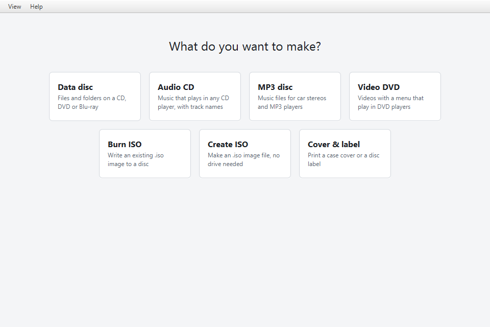
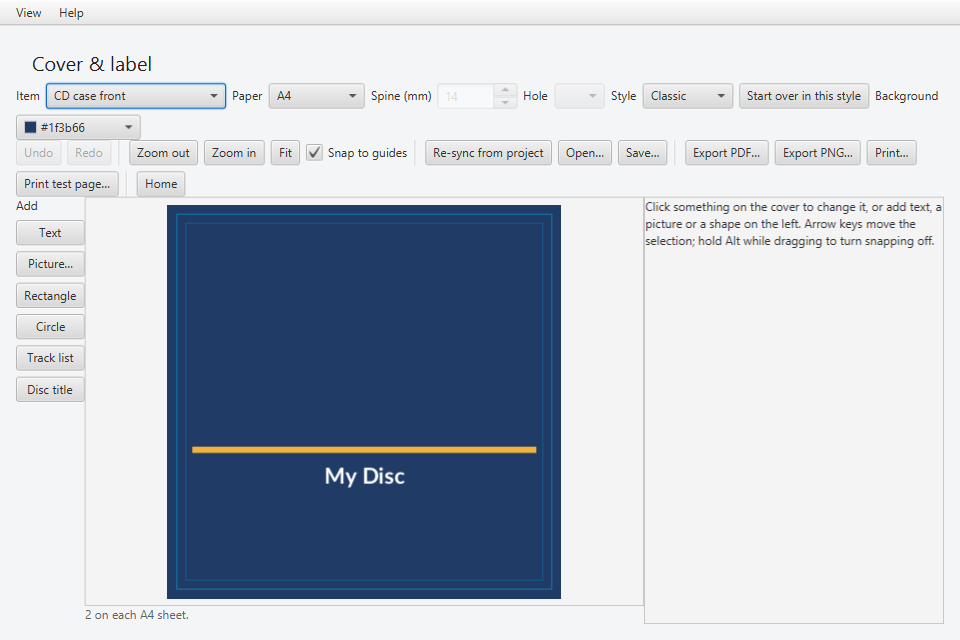
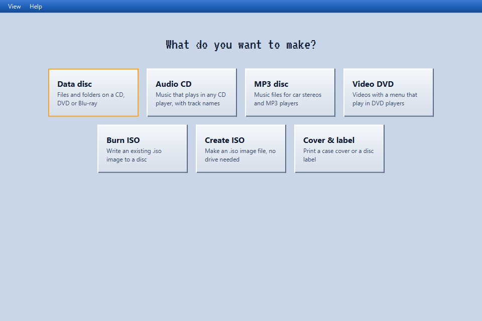
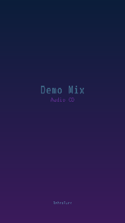

<!--
SPDX-FileCopyrightText: 2026 Chetan and contributors
SPDX-License-Identifier: GPL-3.0-or-later
-->

# RetroBurn

RetroBurn is a free, open-source desktop app for Windows and Linux that burns
CDs, DVDs and Blu-ray discs. It is written in Java with a JavaFX interface and
wraps proven burning technology — open-source tools on Linux and the Windows
Image Mastering API (IMAPI2) on Windows — in one friendly UI.



- **Data discs** and **ISO images**: burn, create, erase rewritable discs,
  and check the disc against what was written.
- **Audio CDs** from your own music files, with track names as CD-Text
  (Linux; Windows burns without CD-Text for now).
- **MP3 discs** laid out for car stereos and older players.
- **Video DVDs** with menus, chapters and "Play all" that play on
  living-room DVD players.
- **Covers and labels**: CD and DVD case inserts and disc labels, exported
  as print-ready PDF or printed at 100 %.

  

- **Retro skins**: a `y2k` theme with bevelled buttons and an LED progress
  bar, a spinning disc, and optional sounds.

  

- **Burn reels**: a 15-second vertical video of your burn, made on your
  computer (the names on the disc are hidden by default).

  

RetroBurn makes no network connections and collects no data.

> **Status:** first release candidate (0.1.0). Everything above is built and
> tested automatically on Linux and Windows; the real-disc and printer checks
> in [docs/MANUAL_TEST.md](docs/MANUAL_TEST.md) are still being run.

## Installing

Packages are attached to each [GitHub Release](../../releases):

- **Windows 10/11**: `RetroBurn-<version>.msi`, or the portable
  `RetroBurn-<version>-windows-portable.zip` (unzip and run
  `RetroBurn.exe`). FFmpeg and dvdauthor come with it. The installer is not
  code-signed yet, so Windows SmartScreen may warn about an unknown
  publisher: choose "More info" → "Run anyway" if you downloaded it from
  this repository's releases and the checksum in `SHA256SUMS` matches.
- **Ubuntu and Debian**: `retroburn_<version>_amd64.deb`
  (`sudo apt install ./retroburn_<version>_amd64.deb`). It pulls in
  xorriso, cdrskin, genisoimage, FFmpeg and dvdauthor from your
  distribution. Your user needs to be in the `cdrom` group to burn.

Each release also has a CycloneDX SBOM and the source of every program
bundled in the Windows packages.

## Building and running

You need JDK 25. Everything else is fetched by the Maven wrapper.

```sh
./mvnw verify        # Linux: build, test and run all checks
./mvnw javafx:run    # Linux: start the app
mvnw.cmd verify      # Windows
mvnw.cmd javafx:run  # Windows
packaging/package.sh image 0.1.0   # an app image in target/package/image
```

The [developer guide](docs/DEVELOPER_GUIDE.md) has the full set-up for both
operating systems, and [docs/RELEASE.md](docs/RELEASE.md) describes the
packages and the release workflow.

## Documentation

Start at [docs/README.md](docs/README.md): architecture, design decisions,
UX specification, glossary and the security threat model.

## Contributing

Contributions are welcome. Please read [CONTRIBUTING.md](CONTRIBUTING.md) and
our [Code of Conduct](CODE_OF_CONDUCT.md). Security issues: see
[SECURITY.md](SECURITY.md).

## Licence

RetroBurn is free software, licensed under the
[GNU General Public License v3.0 or later](LICENSE). The repository follows the
[REUSE](https://reuse.software/) specification; every file states its licence.

## Acknowledgements

RetroBurn stands on the shoulders of other open-source projects. Each one is
credited in the app under Help → Open-source licenses and in
[THIRD_PARTY_NOTICES.md](THIRD_PARTY_NOTICES.md).

- **OpenJDK** and **OpenJFX** — the Java runtime and user interface toolkit
  (GPL-2.0 with the Classpath Exception).
- **Jackson** — reads and writes RetroBurn's JSON files (Apache-2.0).
- **Apache PDFBox** and **FontBox** — PDF export of covers and labels
  (Apache-2.0).
- **Lato** and **VT323** — fonts for covers, labels and the `y2k` skin
  (SIL Open Font License).
- **GNU xorriso**, **cdrskin** and **genisoimage** — burning and disc
  images on Linux (GPL).
- **FFmpeg** with **x264** and **LAME** — audio and video conversion and
  burn reels (GPL / LGPL).
- **dvdauthor** and **spumux** — video DVD authoring (GPL-2.0).
- The **Windows Image Mastering API** — burning on Windows (part of
  Windows).

All screenshots and the demo reel show RetroBurn's own interface and
invented content.
