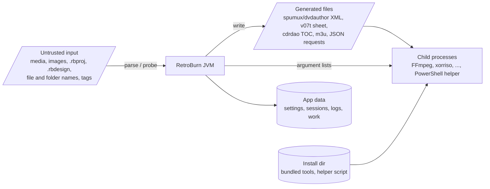

<!--
SPDX-FileCopyrightText: 2026 Chetan and contributors
SPDX-License-Identifier: GPL-3.0-or-later
-->

# Security threat model

| | |
|---|---|
| Status | Draft — reviewed again before the first release |
| Method | STRIDE-lite: list assets and trust boundaries, then threats per boundary |

## 1. Scope and assumptions

RetroBurn is a local desktop app. It makes **no network connections**, runs as
a **standard user**, and processes files the user chooses. The main attack
surface is therefore *malicious or malformed input files* (media, images,
project files) and *how we hand data to other programs* (tools, the Windows
helper, generated XML/sheet/TOC files).

Out of scope: an attacker who already controls the user's account or the
operating system.

## 2. Assets

- The user's files (sources must never be modified or deleted).
- Discs in the drive (must not be written or erased without confirmation).
- The integrity of RetroBurn's own install directory and bundled binaries.
- Local data: settings, session logs (contain file names), logs (contain paths).

## 3. Trust boundaries

## 4. Threats and mitigations

| # | Threat (STRIDE) | Example | Mitigation |
|---|---|---|---|
| T1 | Tampering / EoP via malicious media | Crafted video exploits a decoder bug | Decoding happens in FFmpeg child processes, not in the JVM; tool crashes become clear errors. Bundled FFmpeg is kept up to date per release. |
| T2 | Argument injection | A file named `-o evil` or containing spaces/quotes is interpreted as an option | `ProcessBuilder` with argument lists only, never shell strings. Paths passed as absolute paths, so they never start with `-`. Where a tool supports an end-of-options marker or explicit path syntax, use it (verified per tool in the LLD). |
| T3 | Injection into generated files | A track title containing `"` or newlines breaks a v07t sheet or TOC; a DVD title containing `<` breaks spumux/dvdauthor XML | Every writer escapes or rejects characters according to that format; XML written with a real XML writer; golden tests include hostile strings. CD-Text is restricted to ISO-8859-1 printable characters anyway. |
| T4 | Path traversal / zip slip | A `.rbdesign` ZIP entry named `../../x`; an `.rbproj` referencing system paths | `.rbdesign` entries are read into memory, never extracted; only `design.json` and `images/<sha256>.<ext>` names are accepted, and each image must match its hash (`DesignFile`, tested with traversal names). Project paths are only *read* as sources; outputs go only to user-chosen or app-owned folders. |
| T5 | Resource exhaustion | ZIP bomb in `.rbdesign`; enormous image; project with millions of entries | Size and entry-count limits when reading `.rbdesign` (8 MB JSON, 200 images, 50 MB each, 200 MB in all); picture size read from the header and over 100 million pixels refused before decoding (`ImageStore`); streamed file trees; disk-space pre-checks. |
| T6 | PowerShell helper abuse | User data ending up as executable script text | The helper receives one JSON document on stdin; no value is ever concatenated into script text. PowerShell is started by absolute path from `%SystemRoot%`; the script and its C# source are copied from the application into a per-user folder named after their SHA-256 hash and checked before every start (the installer may later use the read-only install directory). Execution policy is bypassed for that process only; machine and user policy are not changed. |
| T7 | DLL search-order hijack / binary planting (Windows) | A malicious DLL in the work folder is loaded by a bundled tool | Bundled tools are run by absolute path from the install directory (per-machine install, not user-writable); the working directory of tool processes is the job's own work folder created by us. |
| T8 | Supply chain of bundled binaries | A tampered upstream tarball; a compromised MSYS2 package | FFmpeg and dvdauthor are built in CI from pinned tarballs whose SHA-256 is checked (`windows-tools/`); the DLLs they need are MSYS2 packages installed by `msys2/setup-msys2` (signed by MSYS2), recorded with their versions in `tools/manifest.tsv` and the SBOM, and their source packages published with each release (ADR-0019). Release assets carry `SHA256SUMS`. Packages are not code-signed yet (RELEASE.md section 3). |
| T9 | Spoofed releases | Fake installer distributed elsewhere | Releases only via GitHub Releases with SHA-256 checksums. Code signing evaluated (ADR pending); unsigned installers documented in the README. No auto-update channel to hijack. |
| T10 | Destructive action without consent | Bug or race starts a burn/blank on the wrong drive | Confirmation dialog names the drive and the media; drive identity re-checked immediately before writing; blank only offered for rewritable media. |
| T11 | Elevation of privilege | App asks for admin/root to reach the drive | Never. Linux permission problems are explained (`cdrom` group); Windows policy blocks are explained. |
| T12 | Information disclosure | Burn reel or logs reveal private file names | Reel hides item names by default; sessions and logs are local only, never transmitted; logs live in the user's own profile. |
| T13 | Repudiation / diagnosis | User cannot tell what was run | Full command lines, helper requests and outputs logged (local only). |
| T14 | Denial of service via vanished device | USB drive unplugged; tool waits forever | Bounded timeouts on every external wait; drive-lost detection; cancel destroys process trees. |
| T15 | Leaked sleep inhibition | Machine never sleeps after a crash | Inhibitor tied to a child process/thread that dies with the job or the JVM; released in `finally`. |

## 5. Verification

- Unit tests for every writer with hostile input (quotes, newlines, XML
  metacharacters, control characters, very long strings).
- Unit tests for ZIP extraction with traversal and oversized entries.
- Tests for file names with leading dashes, spaces, Unicode and
  Windows-reserved names.
- Architecture test: no use of `Runtime.exec(String)` or shell invocations
  (`sh -c`, `cmd /c`, `powershell -Command`) anywhere.
- Release checklist confirms SBOM, checksums and source archives.
