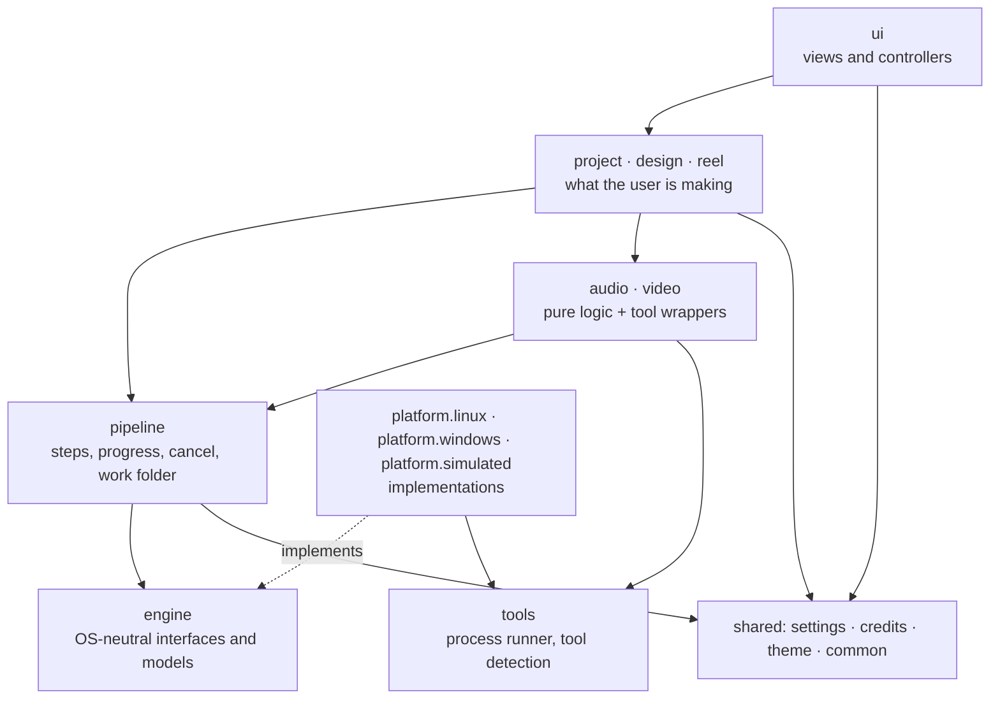
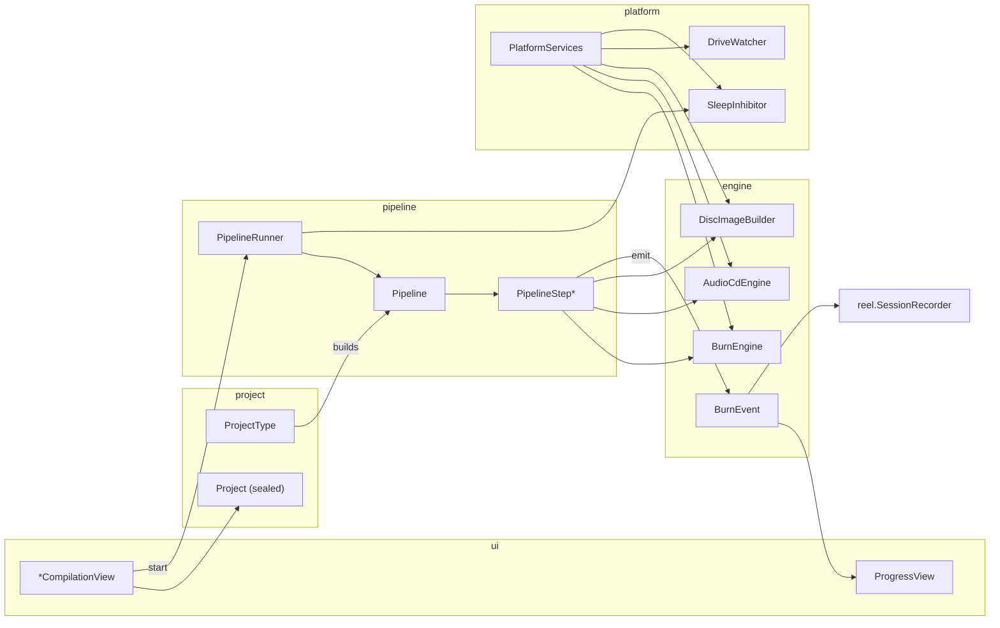
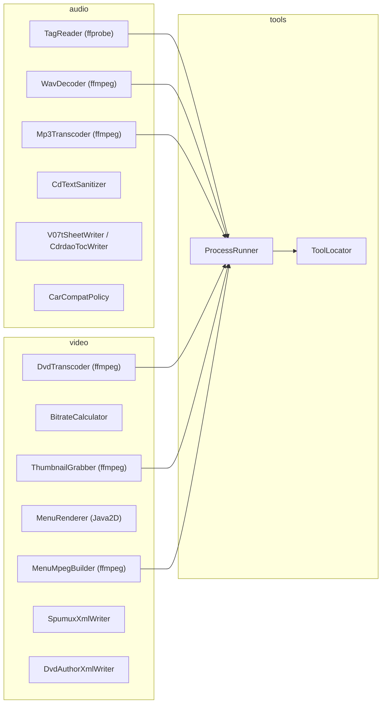
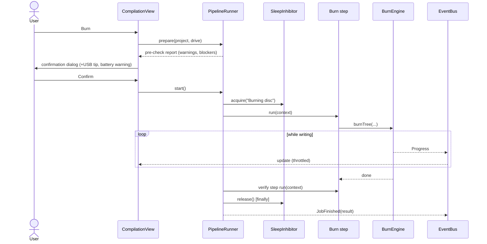
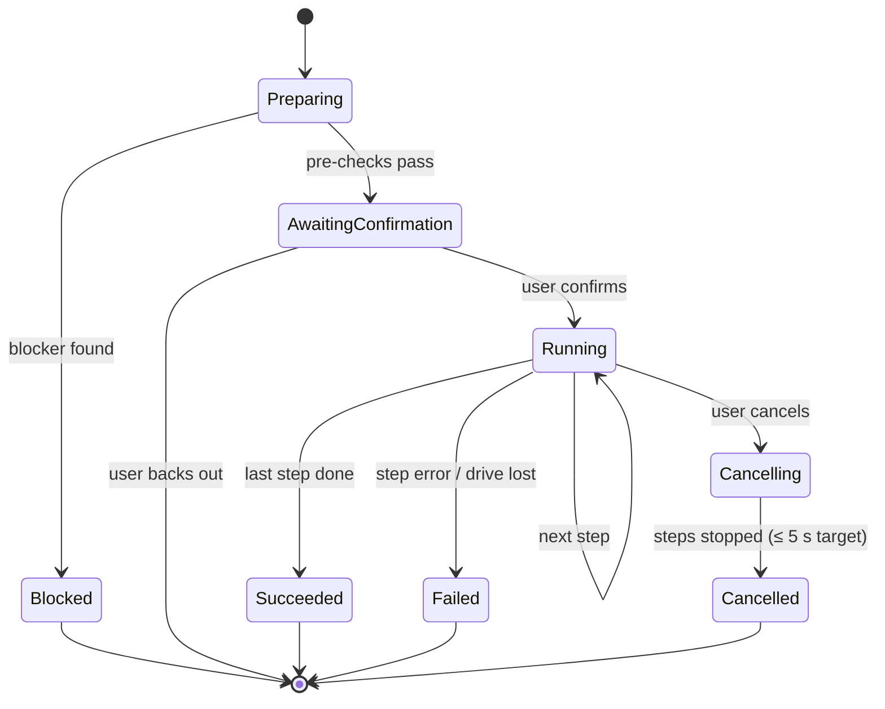
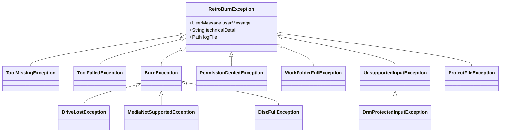

<!--
SPDX-FileCopyrightText: 2026 Chetan and contributors
SPDX-License-Identifier: GPL-3.0-or-later
-->

# RetroBurn — High-Level Design

| | |
|---|---|
| Status | Approved by the owner (2026-10-31); kept up to date as modules are built |
| Read first | [SAD.md](SAD.md) |
| Detailed designs | `docs/design/LLD-<module>.md`, written before each module is built |

This document explains how RetroBurn's code is organised and how the parts
work together. Interface sketches below are illustrative: they fix names and
responsibilities, while exact signatures are settled in each module's LLD.

---

## 1. Layers

Dependencies point downwards only.



Rules (checked by ArchUnit tests, see
[ADR-0009](../adr/0009-platform-isolation-enforced-by-archunit.md)):

1. Only `platform.<os>` packages may contain OS-specific code or call
   OS-specific tools/APIs (xorriso, cdrskin, genisoimage, IMAPI2, cdrdao,
   systemd-inhibit, sysfs, Win32). No `if (isWindows)` anywhere else.
2. Nothing depends on `ui` except `app`; nothing depends on `app`.
3. `engine` depends only on `common`; `common` depends on nothing else in
   RetroBurn.
4. `platform.*` packages do not depend on each other.
5. JavaFX classes are used only in `app`, `ui`, `theme` and the editor part of
   `design`. Everything else is testable headless.
6. Only `app.AppContext` constructs a concrete `PlatformServices` (classes in
   a `platform.<os>` package are used only by that package and by `app`).
7. `Runtime.exec` is never used; only `tools` uses `ProcessBuilder`.

FFmpeg, ffprobe, dvdauthor and spumux are cross-platform tools with identical
command lines on both OSes, so their wrappers live in `audio`, `video` and
`reel`. Only *where the executable is found* is platform-specific, and that is
answered by `PlatformServices.toolLocator()`.

---

## 2. Packages and responsibilities

Root package: `io.aerohelper.retroburn` ([ADR-0007](../adr/0007-package-root.md)).

| Package | Responsibility | Main types |
|---|---|---|
| `app` | Entry point, composition root, navigation, home screen | `RetroBurnApplication`, `AppContext`, `Navigator` |
| `ui` | One view per project type; shared drive bar, confirmation, progress and result views | `DriveBar`, `ConfirmBurnDialog`, `ProgressView`, `ResultView`, `*CompilationView` |
| `theme` | Theme registry, CSS loading, sounds, spinning-disc animation | `Theme`, `ThemeRegistry`, `SoundPlayer`, `DiscAnimation` |
| `project` | Project types and their models; `.rbproj` load/save | `ProjectType`, `Project` (sealed), `ProjectTypeRegistry`, `ProjectFileStore` |
| `pipeline` | Turns a project into ordered, weighted, cancellable steps; owns the work folder | `Pipeline`, `PipelineStep`, `StepContext`, `PipelineRunner`, `DiskSpaceCheck` |
| `engine` | OS-neutral contracts and value types for drives and burning | `BurnEngine`, `AudioCdEngine`, `DiscImageBuilder`, `DriveInfo`, `MediaInfo`, `DriveCapabilities`, `BurnEvent` |
| `platform` | The `PlatformServices` interface and its implementations | `PlatformServices`, `DriveWatcher`, `SleepInhibitor`, `PowerStatus`, `AppPaths`, `ToolLocator` |
| `platform.linux` | xorriso, cdrskin, genisoimage, logind, sysfs | `LinuxPlatform`, `XorrisoEngine`, `XorrisoOutputParser`, `CdrskinAudioEngine`, `GenisoimageDvdImageBuilder` |
| `platform.windows` | IMAPI2 bridge, Windows power and PnP queries, cdrdao if adopted | `WindowsPlatform`, `Imapi2Engine`, `Imapi2Bridge`, `Imapi2DvdImageBuilder` |
| `platform.simulated` | A fake drive for UI work, demos and tests | `SimulatedPlatform`, `SimulatedEngine` |
| `audio` | Tags, decoding, MP3 transcoding, CD-Text model and writers, car-stereo rules | `TagReader`, `WavDecoder`, `Mp3Transcoder`, `CdTextSanitizer`, `V07tSheetWriter`, `CdrdaoTocWriter`, `CarCompatPolicy`, `M3uWriter` |
| `video` | DVD transcoding, bitrate maths, thumbnails, menu layout/rendering, spumux/dvdauthor XML | `DvdTranscoder`, `BitrateCalculator`, `MenuRenderer`, `SpumuxXmlWriter`, `DvdAuthorXmlWriter` |
| `design` | Cover/label documents, print templates, editor commands, PDF/PNG export, printing | `DesignDocument`, `PrintTemplate`, `EditorCommand`, `PdfExporter`, `PngExporter` |
| `reel` | Burn session recording and reel video rendering | `BurnSession`, `SessionRecorder`, `ReelTimeline`, `ReelScene`, `ReelRenderer`, `FfmpegReelEncoder` |
| `tools` | Running external processes safely; detecting tool versions and capabilities | `ProcessRunner`, `ExternalTool`, `ToolStatus`, `ToolCapabilityProbe` |
| `credits` | Third-party component register and licence texts | `ThirdPartyComponent`, `ComponentRegistry` |
| `settings` | User settings model and persistence | `Settings`, `SettingsStore` |
| `common` | App facts, user-visible text, OS family enum, typed errors, event bus, small utilities. Depends on nothing else in RetroBurn. | `AppInfo`, `Messages`, `OperatingSystem`, `RetroBurnException`, `UserMessage`, `EventBus` |

Every feature package has the same shape — **model → service/steps → UI** — so
learning one teaches the rest.

---

## 3. Components (C4 level 3)

### 3.1 Burning core



### 3.2 Media processing



Writers (`*Writer`) and calculators are pure functions with golden-file tests.
Renderers are pure `(model, theme, page/frame) → BufferedImage` and
snapshot-tested.

---

## 4. Core abstractions

### 4.1 Platform

```java
public interface PlatformServices {
    String displayName();                        // "Linux", "Windows"
    AppPaths appPaths();                         // per-OS folders (SAD §6)
    ToolLocator toolLocator();                   // where ffmpeg & co. live
    BurnEngine burnEngine();                     // data/ISO burn, blank, verify, drive info
    Optional<AudioCdEngine> audioCdEngine();     // empty if the needed tool is missing
    DiscImageBuilder discImageBuilder();         // data/MP3 ISO and DVD-Video images
    DriveWatcher driveWatcher();                 // hot-plug
    SleepInhibitor sleepInhibitor();
    PowerStatus powerStatus();                   // on battery? (unknown allowed)
    void openFolder(Path folder);
}
```

| Concern | Linux | Windows |
|---|---|---|
| Drive & media info | xorriso | IMAPI2 `MsftDiscMaster2` / `MsftDiscRecorder2` via the bridge |
| Data / MP3 burn | xorriso | IMAPI2FS image + IMAPI2 data writer |
| ISO without a drive | xorriso writing to a `stdio:` target | IMAPI2FS image stream saved to a file (feasibility confirmed in M3) |
| Burn ISO | xorriso | IMAPI2 data writer fed the image stream |
| Blank / format | xorriso | IMAPI2 erase |
| Verify | xorriso MD5 checking | Read back via the drive letter; SHA-256 compared in Java |
| Audio CD | cdrskin, SAO, CD-Text from a v07t sheet | IMAPI2 audio; CD-Text via cdrdao only if the spike succeeds |
| DVD-Video image | genisoimage in DVD-Video mode | IMAPI2FS with ISO 9660 + UDF 1.02 (validated on hardware players) |
| Hot-plug | Polling while idle (cheap device listing; xorriso only when the set changes) — final choice in LLD | IMAPI2 device add/remove notifications, polling as fallback |
| USB detection | Device's sysfs path | Device's Plug and Play ID |
| Sleep inhibition | `systemd-inhibit` child process (sleep + idle) | `SetThreadExecutionState` held by the burning process |
| Battery | sysfs power-supply info | System power status |

All tool options and API behaviours named here are verified against real
documentation, with captured output fixtures, in the platform LLDs before code
relies on them.

### 4.2 Engines

```java
public interface BurnEngine {
    List<DriveInfo> listDrives() throws BurnException;
    MediaInfo readMedia(DriveId drive) throws BurnException;
    void burnImage(DriveId drive, ImageSource image, BurnOptions options, BurnListener listener, CancelToken cancel);
    void burnTree(DriveId drive, DiscTree tree, BurnOptions options, BurnListener listener, CancelToken cancel);
    void blank(DriveId drive, BlankMode mode, BurnListener listener, CancelToken cancel);
    VerifyReport verify(DriveId drive, VerifyRequest request, BurnListener listener, CancelToken cancel);
}

public interface DiscImageBuilder {
    void buildDataImage(DiscTree tree, ImageOptions options, Path target, BurnListener listener, CancelToken cancel);
    void buildDvdVideoImage(Path videoTsFolder, String volumeLabel, Path target, BurnListener listener, CancelToken cancel);
}

public interface AudioCdEngine {
    void burnAudioCd(DriveId drive, AudioDisc disc, BurnOptions options, BurnListener listener, CancelToken cancel);
    boolean supportsCdText(DriveInfo drive);
}
```

`DiscTree` is a **streamed** description of the disc: entries pairing a path on
disc with a source file. It is iterated, never copied, so 100,000-file
compilations do not duplicate the tree in memory. Renaming for MP3 discs
happens here (disc path differs from source name), so source files are never
copied unless transcoded.

### 4.3 Projects and pipelines

```java
public sealed interface Project
        permits DataProject, AudioCdProject, Mp3Project, DvdVideoProject, IsoBurnProject, IsoCreateProject {}

public interface ProjectType {
    String id();                                    // "data", "audio-cd", ...
    Set<MediaKind> supportedMedia();                // drives the mismatch messages
    Set<ToolRequirement> requiredTools();           // drives feature gating
    Pipeline buildPipeline(Project project, PipelineEnvironment environment);
}

public interface PipelineStep {
    String displayName();                           // "Converting tracks"
    double weight();                                // share of overall progress
    void run(StepContext context) throws RetroBurnException;  // must honour context.cancelToken()
}
```

All project types are registered in one place, `ProjectTypeRegistry`, which is
filled by `AppContext`.

### 4.4 Events

`BurnEvent` is a sealed hierarchy: `StepStarted`, `Progress(fraction, speed,
eta, bufferFill)`, `LogLine`, `StateChanged`, `DriveLost`, `StepFinished`,
`JobFinished(result)`. Engines and steps emit them; `ProgressView`,
`DiscAnimation`, `SoundPlayer` and `SessionRecorder` subscribe through the
`EventBus` in `common`.

---

## 5. Data flow per project type

Every flow ends the same way: **pre-checks → confirmation → sleep inhibitor
acquired → write → verify → inhibitor released → result → session saved**.
Pre-checks are: media fits and matches the project type, the drive supports
what is needed, required tools are present, enough free space in the work
folder, and USB / battery advice shown when relevant.

| Project type | Pipeline steps |
|---|---|
| Data disc | scan sources (background) → build `DiscTree` → burn tree → verify |
| Burn ISO | validate size → burn image → verify against image checksum |
| Create ISO | build `DiscTree` → build data image to file |
| Blank | confirm erase → blank |
| Audio CD | probe tags (ffprobe) → decode to WAV (ffmpeg, bounded parallelism) → optional loudness pass → sanitise CD-Text → write v07t sheet (Linux) or TOC (Windows + cdrdao) → burn audio → read back TOC |
| MP3 disc | probe tags → apply layout and car-compat policy → transcode non-MP3s (optional) → write `.m3u` (optional) → build `DiscTree` with renamed disc paths → burn tree → verify |
| Video DVD | transcode titles (sequential) → thumbnails → render menu PNGs → menu MPEG → spumux → dvdauthor (`VIDEO_TS`) → build DVD-Video image → burn image → verify. May stop after `VIDEO_TS` or after the image. |
| Cover & label | not a pipeline: edit `DesignDocument` → export PDF/PNG or print |
| Burn reel | load `BurnSession` → build `ReelTimeline` → render frames (Java2D) → pipe raw RGB frames to ffmpeg → MP4 in the reels folder |



---

## 6. Pipeline model

### 6.1 Job state machine



### 6.2 Behaviour

- **Weighted progress:** overall progress = Σ(weight × step fraction) of
  finished and running steps. Weights are estimates per step (e.g. bytes to
  write, seconds of media to transcode). ETA uses a smoothed rate.
- **Progress cadence:** steps report at least once a second; the UI throttles
  updates to about 10 per second.
- **Cancellation:** a `CancelToken` is checked by every step. For external
  processes, cancel first asks the tool to stop (where the tool supports a
  clean stop — verified per tool) and then destroys the process tree after a
  short grace period.
- **Work folder:** each job gets its own folder under the work directory. It is
  deleted on success or cancel unless "keep temporary files" is set; on failure
  it is kept until the next start so logs can be inspected, then cleaned up.
- **Disk-space checks:** audio and video jobs estimate output size before
  starting (video needs at least twice the estimate free).
- **Sleep inhibition** is acquired immediately before the first writing step
  and released in a `finally` block after verify. Long DVD transcodes also hold
  it. Both implementations are designed so that a crash of the JVM or helper
  releases the request automatically (the inhibiting process or thread dies
  with it).
- **One burn at a time** in v0.1. Non-burning jobs (ISO creation, reel export)
  may run while no burn is active.

### 6.3 Drive lifecycle and disconnects

- `DriveWatcher` publishes `DrivesChanged` events. It polls only while no burn
  is active, so the active drive is never disturbed.
- During a burn, losing the drive is detected by the engine (tool or helper
  reports a device error, or the device node / drive letter disappears). The
  engine emits `DriveLost`, the runner fails the job with a `DriveLostException`
  and the result view explains that a write-once disc may be unusable and a
  rewritable one can be blanked and reused.
- Every external wait has a bounded timeout, so a vanished device never hangs
  the app.

---

## 7. Threading model

| Thread / pool | Used for |
|---|---|
| JavaFX Application Thread | UI only. Never blocks on I/O, processes, COM or rendering. |
| `pipeline-runner` (single thread) | Runs the active job's steps in order. |
| `media-workers` (bounded, default CPU cores − 1, configurable) | Parallel decoding/probing for audio and MP3 jobs. DVD transcodes run one at a time by default. |
| `process-io` (per process, 2 threads) | Draining stdout/stderr of each child process into parsers and the log, so pipes never fill. |
| `drive-watcher` (scheduled, single thread) | Hot-plug polling; paused during burns. |
| `background-scan` | Size calculation and file-tree walking for large compilations. |

Rules: UI updates go through `Platform.runLater` in the `ui` layer only (events
are marshalled by a small adapter). Shared state crossing threads is immutable
(records) or confined to one thread.

---

## 8. Error handling



- Each exception carries a **user message** (from a resource bundle, plain
  language, says what to do next) and **technical detail** (command line, exit
  code, last log lines). The result view shows the message and offers "Show
  details" with the raw log.
- Parsers map known tool error texts and exit codes to specific exceptions;
  unknown failures become `ToolFailedException` with the full output.
- Logging uses `java.util.logging` with rotating files in the per-OS log
  folder. Full command lines, helper requests and tool output are logged.

---

## 9. Feature gating

At startup (in the background, after the first window shows) `ToolLocator`
finds each tool and `ToolCapabilityProbe` reads its version and relevant
capabilities (e.g. whether FFmpeg has an MP3 encoder or which H.264 encoder is
available). Each `ProjectType` declares its `ToolRequirement`s; the home screen
and views disable exactly the dependent features and explain why.

| Missing | Disabled |
|---|---|
| xorriso (Linux) / IMAPI2 unavailable (Windows) | All burning, ISO creation, verify |
| cdrskin (Linux) | Audio CD |
| cdrdao (Windows, if adopted) | CD-Text only — audio burning continues via IMAPI2 |
| ffmpeg / ffprobe | Audio CD, MP3 transcoding, Video DVD, burn reel |
| ffmpeg without an MP3 encoder | MP3 transcoding only |
| dvdauthor / spumux | Video DVD |
| genisoimage (Linux) | Video DVD image (`VIDEO_TS` export still works) |

Drive-dependent features (CD-Text writing, DVD+R DL, BD, M-DISC) are gated the
same way from `DriveCapabilities`.

---

## 10. Persistence and versioning

| File | Format | Location |
|---|---|---|
| `.rbproj` | JSON | Wherever the user saves it |
| `.rbdesign` | ZIP: JSON + embedded images | Wherever the user saves it |
| Burn session | JSON | App data folder |
| Settings | `settings.properties` | Settings folder |
| Credits register | `components.json` | Bundled resource |

Every JSON document has an integer `schemaVersion`. Loading an older file runs
ordered migrations (`Migration_v1_to_v2`, …), each with tests; loading a newer
one fails with "This file was created by a newer version of RetroBurn". Paths in
project files are stored relative to the project file where possible. Details
go in `docs/DATA_MODEL.md` (M2).

---

## 11. Windows IMAPI2 bridge (overview)

Proposed in [ADR-0005](../adr/0005-windows-imapi2-bridge.md): a bundled,
readable PowerShell 5.1 script that uses the IMAPI2 COM objects.

- Java starts the script with an argument list (no shell string), passes a
  **JSON request on stdin**, and reads **JSON Lines** events from stdout
  (`progress`, `log`, `drive`, `result`, `error`).
- The script never receives interpolated script text; every value arrives as
  data inside the JSON request.
- A pure Java `Imapi2EventParser` handles the event stream and is tested with
  captured real output.
- The same helper performs device-change notification, PnP queries for USB
  detection, and holds the execution-state request for sleep inhibition while
  it burns.

The M3 spike confirms or replaces this choice with JNA in-process COM.

---

## 12. Cross-cutting concerns

- **Internationalisation:** every user-visible string comes from a
  `ResourceBundle`. Text is Unicode-safe everywhere except CD-Text, which is
  restricted by the format.
- **Accessibility:** full keyboard navigation, visible focus, WCAG AA contrast
  in `classic`, and sounds always paired with visible state.
- **Paths:** `java.nio.file.Path` everywhere; no hard-coded separators; names
  with spaces, Unicode and Windows-reserved words (`CON`, `AUX`, …) covered by
  tests.
- **Security:** argument lists only, escaping in every writer, path validation,
  no elevation — see [SECURITY_THREAT_MODEL.md](../SECURITY_THREAT_MODEL.md).
- **Credits:** each tool wrapper's Javadoc names the upstream project, licence
  and homepage; in-context credits appear in the progress and result views.

---

## 13. Testability

- `SimulatedPlatform` provides a fake drive with scriptable behaviour (media
  types, slow burns, failures, unplugging) for UI work, demos, the burn-reel
  demo mode and tests.
- Parsers are tested against captured real output in
  `src/test/resources/tool-output/<tool>/`; writers against golden files in
  `src/test/resources/golden/`.
- Integration tests run real tools on CI: xorriso `stdio:` images on Linux,
  IMAPI2FS images on Windows, FFmpeg/dvdauthor pipelines on both.
- Architecture rules are ArchUnit tests and fail the build.
- Simple benchmarks guard the 100,000-file and memory budgets.

---

## 14. Extension points

Summarised here, detailed in [EXTENSIBILITY.md](../EXTENSIBILITY.md).

| Extension point | Add one by | Core changes needed |
|---|---|---|
| `PlatformServices` | New `platform.<os>` package | One line in `AppContext` |
| `BurnEngine` / `AudioCdEngine` / `DiscImageBuilder` | New implementation in a platform package | None outside that platform |
| `ProjectType` + `PipelineStep`s | New project model, steps and one view | One registration line |
| `Theme` | CSS + assets + sounds in `themes/<name>/` | None |
| `MenuTemplate` | Data file + images (optionally one small class) | None |
| `PrintTemplate` | Data file | None |
| `ReelScene` | One small class | One registration line |

---

## 15. Questions to settle in LLDs

| Question | Decided in |
|---|---|
| JPMS modules vs. classpath for the app jars (affects `jlink`/`jpackage` with non-modular libraries) | M1 build LLD + ADR |
| Linux hot-plug: polling source and interval vs. udev events | Linux engine LLD (M2) |
| Exact xorriso / cdrskin / genisoimage options and output formats | Linux engine LLDs (M2, M5, M7), with fixtures |
| IMAPI2 bridge: PowerShell helper vs. JNA; drive-less image creation | Windows engine spike + ADR (M3) |
| Windows CD-Text via cdrdao | Audio CD spike + ADR (M5), owner approval |
| IMAPI2FS UDF 1.02 images accepted by hardware DVD players | Video DVD LLD (M7), fallback ADR if not |
| Theme API shape for the disc animation and sounds | Theme LLD (M4/M9) |
