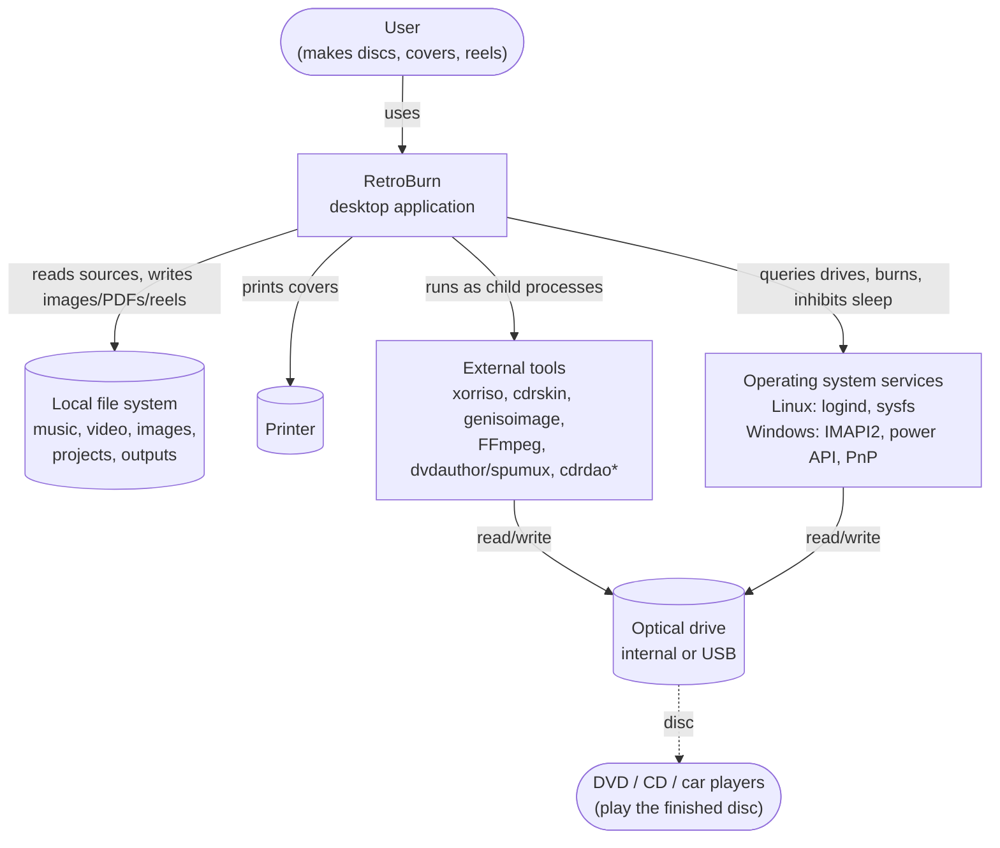
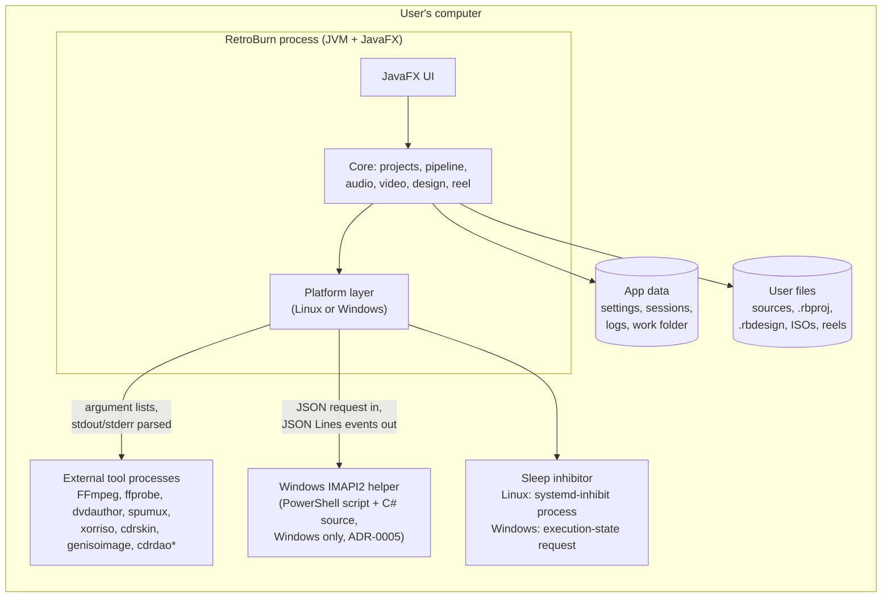

<!--
SPDX-FileCopyrightText: 2026 Chetan and contributors
SPDX-License-Identifier: GPL-3.0-or-later
-->

# RetroBurn — Solution Architecture Document

| | |
|---|---|
| Status | Draft for owner review |
| Applies to | v0.1 (Windows + Linux) |
| Companion | [HLD.md](HLD.md) (how the code is organised), [ADRs](../adr/) |

This document is the public, self-contained description of what RetroBurn must
do and how the solution is shaped. Anyone working on the project should be able
to understand the product's scope and constraints from this file alone.

---

## 1. Product summary

RetroBurn is a free, open-source desktop application for **Windows and Linux**
that burns CDs, DVDs and Blu-ray discs. It is written in Java with a JavaFX
user interface. It does not implement low-level burning itself; it drives
proven burning technology:

- on **Linux**, open-source command-line tools installed from the distribution
  (GNU xorriso, cdrskin, genisoimage, FFmpeg, dvdauthor);
- on **Windows**, the Image Mastering API v2 (IMAPI2) built into Windows, plus
  FFmpeg and dvdauthor bundled with the installer.

On top of plain burning, it targets a younger audience with a creative,
playful workflow: make the disc, design its cover, and share a short video of
the burn.

### 1.1 What the user can make

| Project type | What it produces | Media |
|---|---|---|
| Data disc | Files and folders, readable on Windows and Linux | CD, DVD, DVD DL, BD |
| Audio CD | A standard audio CD (with CD-Text where supported) from the user's music files | CD-R/RW only |
| MP3 disc | A data disc of MP3s laid out for car stereos and older players | CD, DVD, DVD DL, BD |
| Video DVD | A DVD-Video disc with menus that plays on living-room DVD players | DVD±R/RW (DVD+R DL best-effort) |
| Burn ISO | Writes an existing `.iso` image to disc | Any, size permitting |
| Create ISO | Writes a compilation to an `.iso` file — no drive needed | — |
| Cover & label | Print-ready PDF/PNG covers, inlays and disc labels | Paper / label stock |

Supporting features shared by all project types: drive detection with hot-plug,
blank/format of rewritable media, verify-after-burn, retro themes with an
animated disc and sounds, a one-tap 15-second vertical "burn reel" video, an
in-app open-source credits screen, and a dependency check that disables only
the features whose tools are missing.

### 1.2 Functional requirements (summary)

**Drives and media**
- List optical drives (Linux: device paths such as `/dev/sr0`; Windows: drive
  letter and model), the inserted media type, its state (blank / appendable /
  closed) and free capacity (bytes; minutes for audio CDs).
- Show whether a drive is connected by USB when this can be determined; show
  nothing rather than guess.
- Detect drives being plugged in or removed within about 3 seconds while the
  app is open. Drive polling pauses while a burn is running.
- With no drive attached, show a friendly empty state, not an error.
- Explain permission problems (Linux: membership of the `cdrom` group; Windows:
  burning blocked by policy). The app never needs administrator or root rights.
- Features that depend on drive capability (CD-Text writing, DVD+R DL, BD,
  M-DISC) are enabled only when the drive reports support.

**Burning workflow (all project types)**
- Every destructive action (burn, blank, format) needs explicit confirmation.
- Media / project mismatches are explained in words, not just shown as
  disabled buttons (e.g. "Audio CDs can only be burned on CD-R or CD-RW").
- Live progress: percentage, speed, time remaining and buffer fill where
  available. Cancel warns that write-once media may become unusable.
- Verify after burn is on by default for data, MP3, ISO and video discs.
- While a burn runs, the computer is kept from going to sleep; the request is
  always released afterwards, even after a failure or crash.
- On a USB drive: show a short tip about power (direct connection, Y-cable or
  powered hub, laptop on charger); warn if the laptop is running on battery.
- If the drive disappears or loses power mid-burn, stop cleanly, explain what
  happened and what the disc's state probably is, and never hang.
- The app never changes operating-system power settings.

**Data disc and ISO**
- Drag-and-drop compilation with a capacity bar that blocks over-capacity burns.
- Volume label limits enforced. File systems chosen so the disc reads on both
  OSes (Linux: ISO 9660 + Rock Ridge + Joliet; Windows: ISO 9660 + Joliet, UDF
  added automatically for files over 4 GB or BD media).
- Multisession ("leave disc open") offered where the platform supports it.

**Audio CD**
- Inputs: any audio format FFmpeg can decode. DRM-protected files are rejected
  with a clear message.
- Track editor (reorder, remove, title/performer per track and album),
  pre-filled from file tags, falling back to the file name.
- Capacity shown as mm:ss against 74/80 minutes; at most 99 tracks.
- Tracks are converted to 44.1 kHz / 16-bit / stereo WAV in a work folder;
  originals are never modified. Optional loudness normalisation (off by
  default). Standard 2-second gaps.
- CD-Text limited to ISO-8859-1: accents are stripped where possible; for other
  scripts the user is asked for a Latin-script version (originals still appear
  on covers and reels).
- Linux writes CD-Text with cdrskin. Windows writes audio with IMAPI2; CD-Text
  on Windows depends on a spike evaluating a bundled cdrdao (see
  [ADR-0006](../adr/0006-external-tool-provisioning-per-os.md) and
  [RISKS.md](../RISKS.md)).

**MP3 disc**
- MP3 files are copied byte-for-byte, never re-encoded. Other formats can be
  transcoded to MP3 (default 192 kbps CBR).
- Layouts: keep folders, `Artist/Album/` from tags, or flat.
- "Car stereo compatibility" mode (on by default): track-number prefixes,
  sanitised and length-limited names, limited folder depth, warnings on large
  folder and file counts, closed disc.
- Renaming happens only inside the disc image; source files are not copied
  unless transcoded.

**Video DVD**
- Inputs: any non-DRM video FFmpeg can decode; up to 99 titles.
- PAL or NTSC (default from locale), 16:9 / 4:3 auto-detected, AC-3 stereo
  audio, automatic chapters every N minutes plus manual chapters.
- Video bitrate chosen to fit the disc, with a safety margin and DVD-safe
  limits; warns when quality will be low.
- Menu templates (`classic`, `y2k`, `minimal`) with thumbnails, Play all,
  paging, optional short background music, live preview.
- Output to disc, to `.iso`, or to a `VIDEO_TS` folder.
- Requires at least twice the estimated output size free in the work folder.

**Cover & label designer**
- Data-driven templates: CD jewel case front, back inlay with spines, slim
  insert, DVD keep-case wrap, disc label.
- A4 or US Letter, crop marks, bleed, safe-zone guides, multiple items per
  sheet.
- Editor with text, image, shape, auto-tracklist and title elements; undo/redo
  of at least 50 steps; bundled open-licensed fonts plus system fonts.
- Auto-fill from the current project.
- Export to PDF (vector, embedded fonts) and 300 dpi PNG; print at 100 % scale
  with an alignment test page.

**Themes, sounds and burn reel**
- At least two themes, `classic` (default) and `y2k`, switchable live.
- Animated spinning disc that follows the burn state; optional sounds, all
  original or CC0.
- Every burn records a local session log. After a successful burn the user can
  generate a 1080×1920, ~15-second MP4 timelapse with the label, progress and a
  closing card. Item names are hidden by default. Nothing is uploaded.

**Credits and settings**
- Help → About and Help → Open-source licenses, listing every third-party
  component with its licence text, available offline.
- First-launch and settings dependency check with fix hints; missing tools
  disable only the features that need them.

### 1.3 Out of scope for v0.1

macOS (the architecture must allow it later); Blu-ray movie authoring; VCD /
SVCD; disc-to-disc copy; CD ripping; posting to social networks; telemetry,
accounts, auto-update or any network access; LightScribe/LabelFlash.

**Never in any version:** circumvention of DRM or copy protection.

Planned after v0.1: phone-to-disc over local Wi-Fi; photo slideshow DVDs;
archival "vault" mode with M-DISC and checksum catalogues; bootable discs,
disc spanning, gapless audio, transliteration of non-Latin CD-Text; macOS.

---

## 2. Quality attributes

| Attribute | Target | How the architecture addresses it |
|---|---|---|
| Safety | No destructive action without confirmation | Single shared confirmation step in every burn pipeline. |
| Robustness | Clear message + raw log for ejects, unplugging, tool crashes, full disc/disk, permission errors, bad input | Typed errors carrying a user message and technical detail; bounded timeouts on every external call. |
| Responsiveness | UI never blocks; progress at least once a second; cancel within 5 s | All I/O and rendering off the JavaFX thread; cancellable pipeline steps. |
| Scalability | 100,000 files / 50 GB compilations; 99 tracks / titles; 512 MB heap for typical jobs | Virtualised lists, background size calculation, streamed file trees. |
| Startup | Cold start under 3 s | Lazy tool detection; no heavy work before the first window. |
| Privacy | No network access, no telemetry | No networking code; sessions stored locally only. |
| Security | No shell strings; escaped writers; validated paths; no elevation | See [SECURITY_THREAT_MODEL.md](../SECURITY_THREAT_MODEL.md). |
| Accessibility | Keyboard navigable; default theme meets WCAG AA contrast; sound never the only signal | UX rules in [UX_SPEC.md](../ux/UX_SPEC.md). |
| Portability | Adding an OS touches only a new platform package | `PlatformServices` abstraction enforced by architecture tests. |
| Maintainability | A new Java developer can change a module safely after reading its LLD | Small classes, explicit wiring, per-package docs, "how to change safely" sections. |
| Internationalisation | Ready for translation; Unicode-safe | Strings in resource bundles; English only in v0.1. |
| Quality | ≥ 70 % unit-test coverage of non-UI code | Pure parsers/writers/renderers tested with fixtures and golden files. |

---

## 3. Constraints

- **Licence:** GPL-3.0-or-later for RetroBurn itself ([ADR-0002](../adr/0002-project-license-gpl-3-0-or-later.md)).
  Every dependency must be GPL-3.0-compatible and registered in the third-party
  notices before use.
- **Language and UI:** Java (current LTS, no preview features) and OpenJFX
  ([ADR-0003](../adr/0003-java-lts-and-javafx.md)).
- **Runtime libraries:** OpenJFX, Apache PDFBox (+ FontBox, Commons Logging),
  and Jackson (JNA was considered for the Windows bridge and not needed). Anything else needs a
  register entry first; JDK built-ins are preferred.
- **External tools run as separate processes**; RetroBurn links none of their
  code ([ADR-0004](../adr/0004-external-tools-as-separate-processes.md)).
- **No administrator/root rights**, no changes to OS power settings.
- **No network access** of any kind.
- **No third-party media or brand assets** in the repository; all test media is
  generated synthetically.
- **External tool behaviour is never assumed**: command-line options and output
  formats are checked against real documentation and captured real output
  before code depends on them.

---

## 4. System context (C4 level 1)

\* cdrdao only on Windows and only if adopted for CD-Text.

There are no network connections. Everything happens on the user's machine.

---

## 5. Containers (C4 level 2)

| Container | Technology | Responsibility |
|---|---|---|
| RetroBurn process | Java + JavaFX, packaged with a trimmed runtime (`jlink` / `jpackage`) | Everything the user sees; orchestration of all work. |
| Windows IMAPI2 helper | PowerShell 5.1 script and C# source compiled at start, shipped with the app ([ADR-0005](../adr/0005-windows-imapi2-bridge.md)) | Talks to IMAPI2 COM objects; reports progress as JSON Lines. |
| External tool processes | Native executables | Encoding, authoring, imaging and (Linux) burning. |
| Sleep inhibitor | OS facility | Keeps the machine awake during a burn. |
| App data | Files in per-OS standard folders | Settings, session logs, rotating logs, temporary work folders. |

---

## 6. Deployment

### 6.1 Linux

| Item | Value |
|---|---|
| Distributions | Ubuntu 22.04+, Debian 12+ (primary); Fedora best-effort |
| Architecture | x86_64 |
| Package | `.deb` built with `jpackage` (an `.rpm` is desirable) |
| Runtime | Trimmed Java runtime bundled in the package |
| External tools | **Not bundled.** Declared as package dependencies (xorriso, cdrskin, ffmpeg, dvdauthor, genisoimage — exact package names verified when packaging) |
| Permissions | User must be in the `cdrom` group (or equivalent); the app explains this |

| Purpose | Location |
|---|---|
| Settings | `~/.config/retroburn/` |
| Sessions and data | `~/.local/share/retroburn/` |
| Logs | `~/.local/state/retroburn/logs/` |
| Work / cache | `~/.cache/retroburn/work/` |
| Burn reels | `~/Videos/RetroBurn/` |

(Locations follow the XDG base-directory conventions, honouring the
corresponding `XDG_*` environment variables when set.)

### 6.2 Windows

| Item | Value |
|---|---|
| Versions | Windows 11 (primary); Windows 10 22H2 best-effort |
| Architecture | x86_64 |
| Package | `.msi` installer built with `jpackage`; portable `.zip` desirable |
| Runtime | Trimmed Java runtime bundled |
| Burning | IMAPI2 / IMAPI2FS, part of Windows (not redistributed) |
| External tools | **Bundled** under the install directory: FFmpeg, dvdauthor/spumux and their DLLs, cdrdao if adopted. Built in CI from pinned sources. |
| Permissions | Standard user; no elevation |

| Purpose | Location |
|---|---|
| Settings | `%APPDATA%\RetroBurn\` |
| Sessions and data | `%LOCALAPPDATA%\RetroBurn\data\` |
| Logs | `%LOCALAPPDATA%\RetroBurn\logs\` |
| Work / cache | `%LOCALAPPDATA%\RetroBurn\work\` |
| Burn reels | The user's Videos known folder, `\RetroBurn\` |

All of these are resolved by a single `AppPaths` service and never hard-coded
elsewhere.

### 6.3 Build and release

- Maven (wrapper committed). `verify` compiles, runs tests, checks formatting,
  licence headers and architecture rules.
- GitHub Actions matrix on `ubuntu-latest` and `windows-latest` for every push
  and pull request. A separate workflow builds the bundled Windows tools from
  pinned source and archives that source.
- Tagged releases publish `.deb`, `.msi`, `.zip`, SHA-256 checksums, a
  CycloneDX SBOM and the corresponding source of every bundled binary.

---

## 7. Key decisions

| ADR | Decision | Status |
|---|---|---|
| [0001](../adr/0001-record-architecture-decisions.md) | Record decisions as MADR-style ADRs | Accepted |
| [0002](../adr/0002-project-license-gpl-3-0-or-later.md) | License RetroBurn under GPL-3.0-or-later | Accepted |
| [0003](../adr/0003-java-lts-and-javafx.md) | Java 25 LTS + OpenJFX 25, Maven | Accepted |
| [0004](../adr/0004-external-tools-as-separate-processes.md) | Use external tools as child processes, never linked | Accepted |
| [0005](../adr/0005-windows-imapi2-bridge.md) | Reach IMAPI2 through a PowerShell helper (C# compiled at start for event sinks) — confirmed by spike | Accepted |
| [0006](../adr/0006-external-tool-provisioning-per-os.md) | Linux: distro packages; Windows: bundle tools built in our CI | Proposed |
| [0007](../adr/0007-package-root.md) | Java package root `io.aerohelper.retroburn` | Accepted |
| [0008](../adr/0008-hand-wired-composition-root.md) | Wire objects by hand in `AppContext`; no DI framework | Accepted |
| [0009](../adr/0009-platform-isolation-enforced-by-archunit.md) | Only `platform.<os>` packages contain OS-specific code, checked by ArchUnit | Accepted |

---

## 8. Compliance overview

- **Own code:** GPL-3.0-or-later; SPDX headers in every source file; the
  repository passes `reuse lint`.
- **External tools on Linux:** installed from the distribution, not
  redistributed by us. Credited by name, licence and homepage in the app.
- **External tools on Windows:** redistributed, so each release ships their
  licence texts and notices (including those of their DLL dependencies),
  publishes the exact corresponding source as release assets, records FFmpeg's
  build configuration (never `--enable-nonfree`), and lists everything in a
  CycloneDX SBOM.
- **IMAPI2:** part of Windows, used but not redistributed; credited by name
  only.
- **Java libraries:** Apache-2.0 (PDFBox, Commons Logging, Jackson; JNA if used)
  and GPL-2.0-with-Classpath-exception (OpenJDK, OpenJFX). Apache `NOTICE`
  contents are reproduced. Runtime images keep the JDK/JavaFX legal files.
- **Assets:** original (GPL-3.0-or-later or CC-BY-SA-4.0), CC0 or OFL fonts
  only. No logos of any product or project. Proper names are used ("GNU
  xorriso", "FFmpeg", "Apache PDFBox").
- **In-app credits** come from one data file (`credits/components.json`) that
  is also the source for `THIRD_PARTY_NOTICES.md`; a test fails if any runtime
  dependency or bundled binary lacks an entry and licence text.

This is engineering guidance, not legal advice.

---

## 9. Delivery plan

Work proceeds in milestones; each one ends with green CI on Linux and Windows
and its documents updated to match the code.

| Milestone | Content |
|---|---|
| M0 | Architecture and design documents (this set). HLD approved by the owner. |
| M1 | Project skeleton, licence/REUSE compliance, CI matrix, credits screens, developer guide. |
| M2 | Core services, tool runner, pipeline, Linux engine (drives, ISO creation, hot-plug, sleep, battery). |
| M3 | Windows engine (IMAPI2 bridge spike, drives, burn, ISO, blank, verify, hot-plug, sleep, battery). |
| M4 | Data-burning UI, shared drive bar / confirm / progress / result views, `classic` theme. |
| M5 | Audio CD with CD-Text (including the Windows CD-Text spike). |
| M6 | MP3 disc. |
| M7 | Video DVD authoring. |
| M8 | Cover and label designer. |
| M9 | Retro themes and sounds. |
| M10 | Burn reel. |
| M11 | Packaging, compliance artefacts and the first release. |
