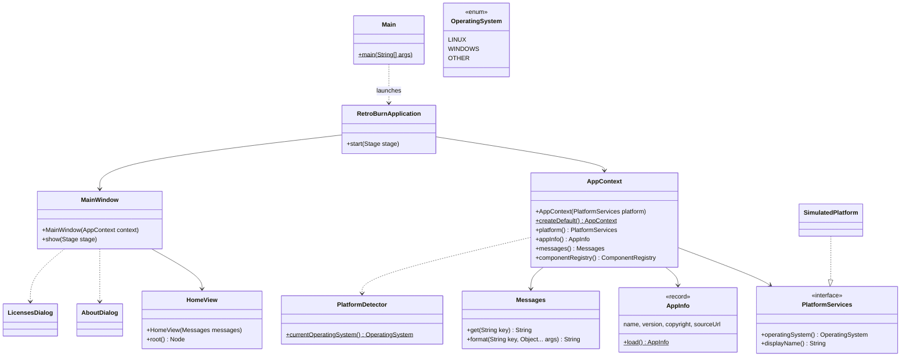
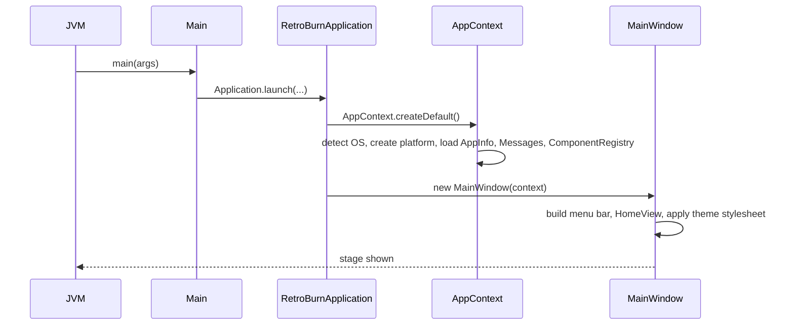

<!--
SPDX-FileCopyrightText: 2026 Chetan and contributors
SPDX-License-Identifier: GPL-3.0-or-later
-->

# LLD — Application shell (`app`, `ui` home, `platform` selection, i18n)

| | |
|---|---|
| Status | Implemented in the skeleton milestone (M1) |
| Packages | `io.aerohelper.retroburn.app`, `.ui`, `.platform`, `.platform.simulated`, `.common` |
| Related | [HLD §1–2](../architecture/HLD.md), [ADR-0008](../adr/0008-hand-wired-composition-root.md), [ADR-0010](../adr/0010-classpath-application-on-jlinked-javafx-runtime.md) |

## 1. Purpose

Start the JavaFX application, wire the long-lived objects in one place, show
the main window with the home screen and the Help menu, and pick the platform
implementation for the current OS.

## 2. Classes

| Class | Responsibility |
|---|---|
| `Main` | Plain `main` method that calls `Application.launch(RetroBurnApplication.class)`. Keeping it separate from the `Application` subclass lets the app start whether JavaFX is on the module path (runtime image, `javafx:run`) or not. |
| `RetroBurnApplication` | JavaFX lifecycle only: builds `AppContext`, creates `MainWindow`. |
| `AppContext` | Composition root. Constructs every long-lived object by hand and is the only place that chooses a `PlatformServices` implementation. |
| `AppInfo` (`common`) | Name, version, copyright line and source URL, read from the filtered `app.properties` resource (the version comes from the Maven build). Lives in `common` because the About dialog in `ui` needs it and nothing may depend on `app`. |
| `MainWindow` | Window title, menu bar (Help → About, Help → Open-source licenses), stylesheet, home screen in the centre. |
| `HomeView` (`ui`) | "What do you want to make?" with one card per project type. In M1 every card is disabled with the reason "Not available yet". |
| `AboutDialog`, `LicensesDialog` (`ui`) | See [LLD-credits.md](LLD-credits.md). Both apply the main window's stylesheets through the package-private `Dialogs` helper, because dialogs get their own scene. |
| `Messages` (`common`) | Thin wrapper around the `i18n.messages` `ResourceBundle` with `MessageFormat` formatting. |
| `OperatingSystem` (`common`) | OS families RetroBurn knows about; plain data used by credits filtering. |
| `PlatformServices` (`platform`) | The OS integration bundle. In M1 it exposes only the OS and a display name; engines, paths, drive watcher, sleep inhibitor and power status are added in M2/M3 as described in the HLD. |
| `PlatformDetector` (`platform`) | Reads the `os.name` system property. The only place outside `platform.<os>` packages where the OS is determined. |
| `SimulatedPlatform` (`platform.simulated`) | Fake platform used until real ones exist, and later for demos and tests. Reports the host OS so the credits screen shows the components relevant to it. |

## 3. Start-up sequence

The credits register is small and loaded eagerly; anything slow (tool
detection, from M2) runs in the background after the window is visible to keep
cold start under 3 seconds.

## 4. Platform selection

`AppContext.createDefault()` asks `PlatformDetector` for the OS and, until the
Linux (M2) and Windows (M3) platforms exist, always creates a
`SimulatedPlatform` for it. When a real platform is added, this method is the
only code that changes. Tests construct `AppContext` with any
`PlatformServices` they like.

## 5. Resources

| Resource | Content |
|---|---|
| `app.properties` | `app.name`, `app.version` (filtered from `${project.version}`), `app.copyright`, `app.sourceUrl` |
| `i18n/messages.properties` | All user-visible strings (English). Keys are grouped by screen: `home.*`, `menu.*`, `about.*`, `licenses.*`. |
| `themes/classic/theme.css` | Minimal base stylesheet using the theme tokens from the UX spec. The full theme system arrives with the data-burning UI. |

## 6. Architecture rules (ArchUnit, `ArchitectureTest`)

1. Classes in a `platform.<os>` package are used only by that package and by
   `app`, which wires them.
2. `platform.<os>` packages do not depend on each other.
3. No class outside `app` depends on `ui`, and nothing outside `app` depends
   on `app`.
4. JavaFX (`javafx..`) is used only in `app`, `ui`, `theme` and `design`.
5. `engine` depends only on `common` and the JDK; `common` depends only on the
   JDK.
6. `Runtime.exec` is never called; `ProcessBuilder` is used only in `tools`.

Rules that refer to packages without classes yet pass (empty packages are
allowed), so they guard future code from day one.

## 7. Error cases

| Case | Behaviour |
|---|---|
| `app.properties` or `messages.properties` missing | Packaging bug: fail fast with `IllegalStateException` naming the resource. |
| Unknown OS | `OperatingSystem.OTHER`; the credits screen lists every registered component so nothing goes uncredited. |

## 8. How to change this safely

- New long-lived objects are created in `AppContext` and passed through
  constructors. Do not add static singletons.
- Keep `RetroBurnApplication` free of logic; put screen code in `ui`.
- Add every new string to `messages.properties`; never hard-code UI text.
- Run `mvnw verify` — `ArchitectureTest` fails if a dependency rule is broken.
  If a rule must change, update this LLD and the HLD in the same change, and
  add an ADR when the layering itself changes.
- Start the app with `mvnw javafx:run` and check Help → About and Help →
  Open-source licenses after changing anything here.
