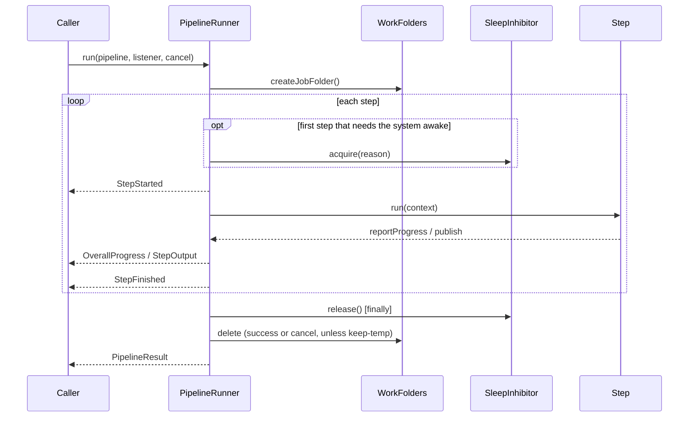

<!--
SPDX-FileCopyrightText: 2026 Chetan and contributors
SPDX-License-Identifier: GPL-3.0-or-later
-->

# LLD — Pipeline (`pipeline`)

| | |
|---|---|
| Status | Implemented in the core milestone (M2) |
| Package | `io.aerohelper.retroburn.pipeline` |
| Related | [HLD §6](../architecture/HLD.md) |

## 1. Purpose

Run a job — create an ISO, burn a disc, author a DVD — as ordered, weighted,
cancellable steps; give it a private work folder; keep the computer awake
while the disc is being written; report progress as events.

## 2. Classes

| Class | Responsibility |
|---|---|
| `PipelineStep` (interface) | `name()` (a `UserMessage`), `weight()`, `needsSystemAwake()`, `run(StepContext)`. |
| `Pipeline` (record) | Ordered list of steps; validates that there is at least one and that weights are positive. |
| `StepContext` | What a step may use: its job's work folder, the `CancelToken`, `reportProgress(fraction)` and `publish(BurnEvent)`. |
| `PipelineEvent` (sealed) | `StepStarted`, `StepFinished`, `OverallProgress(fraction)`, `StepOutput(BurnEvent)`, `SleepInhibitionUnavailable`. |
| `PipelineListener` | Receives `PipelineEvent`s one at a time, on background threads (the pipeline thread or a tool's output thread). |
| `PipelineResult` (sealed) | `Succeeded`, `Failed(RetroBurnException, Path keptWorkFolder)`, `Cancelled`. |
| `PipelineRunner` | Runs a pipeline: work folder, progress weighting, sleep inhibition, cancel, clean-up. Per-run `Options` carry the "prevent sleep" and "keep temporary files" settings. |
| `WorkFolders` | Creates `job-<timestamp>-<random>` folders under the work root, deletes them, and clears leftovers at start-up. |
| `DiskSpaceCheck` | Throws `WorkFolderFullException` when a folder has less usable space than required. |

`CancelToken` lives in `common` because engines and the process runner use it
too.

## 3. Run sequence

## 4. Rules

- **Weighted progress:** overall = (Σ weights of finished steps + current
  weight × current fraction) ÷ Σ all weights. Fractions are clamped to 0..1 and
  never move backwards.
- **Cancellation:** checked before every step; steps check the token
  themselves while working. A cancelled job deletes its work folder.
- **Sleep inhibition:** acquired immediately before the first step whose
  `needsSystemAwake()` is true and released in a `finally` block after the last
  step — so a verify step that follows a burn step is covered. Disabled by the
  "prevent sleep while burning" setting. If the platform cannot inhibit sleep,
  the job continues and a `SleepInhibitionUnavailable` event lets the UI warn.
- **Work folder:** deleted on success and cancel unless "keep temporary files"
  is on; kept on failure so its logs can be inspected, and removed by
  `WorkFolders.deleteLeftovers()` at the next start-up.
- **Errors:** a step's `RetroBurnException` fails the job as-is; any other
  `RuntimeException` is wrapped in a `RetroBurnException` with a generic user
  message so the UI always has something sensible to show.
- **Threading:** `run` blocks the calling thread; the caller runs it on the
  pipeline thread, never on the JavaFX Application Thread. Engines may report
  from their output threads, so progress tracking is synchronized and listener
  calls are serialized.

## 5. How to change this safely

- Steps must not touch the file system outside their work folder and their
  explicit output paths.
- Every long loop in a step must check the cancel token.
- `PipelineRunnerTest` covers weighting, ordering, cancellation, failure,
  work-folder clean-up and sleep-inhibitor release in every outcome; extend it
  when changing the runner.
