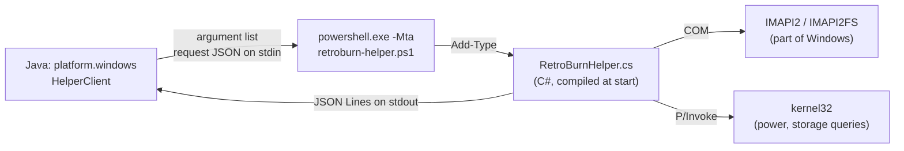

<!--
SPDX-FileCopyrightText: 2026 Chetan and contributors
SPDX-License-Identifier: GPL-3.0-or-later
-->

# LLD — Windows platform (`platform.windows`)

| | |
|---|---|
| Status | Implemented in the Windows engine milestone (M3) |
| Package | `io.aerohelper.retroburn.platform.windows`, helper in `src/main/resources/windows-helper/` |
| Related | [ADR-0005](../adr/0005-windows-imapi2-bridge.md), [LLD-engine-and-platform.md](LLD-engine-and-platform.md), [LLD-tools.md](LLD-tools.md), [LLD-linux-platform.md](LLD-linux-platform.md) |

## 1. Overview

RetroBurn reaches Windows' Image Mastering API v2 (IMAPI2, IMAPI2FS) through a
**helper**: Windows PowerShell 5.1 runs a short bundled script, which compiles
the bundled C# source with `Add-Type` and hands over to it. The C# does the
work: it drives the IMAPI2 COM objects, receives their events, and writes
**JSON Lines** to stdout. Java sends one JSON request on stdin.



Why C# inside the helper: IMAPI2 calls its event sinks on its own worker
thread, where PowerShell script blocks cannot run (verified; see ADR-0005).

Every operation is one helper process. Short operations take about 1.3 s
(start-up and compilation, measured); long-lived helpers serve hot-plug
watching and keeping the computer awake.

## 2. Java classes

| Class | Responsibility |
|---|---|
| `WindowsPlatform` | Wires everything below; supplies the Windows feature requirement table. |
| `WindowsAppPaths` | Folders from `%APPDATA%`, `%LOCALAPPDATA%` and `%USERPROFILE%` (section 9). |
| `HelperFiles` | Copies the helper's two files from the class path into a folder named after their SHA-256 hash under the data folder, and checks the hash before every start. |
| `HelperRequest` | Builds the request JSON for each operation (static factories). |
| `HelperEvent` (sealed) | One parsed output line: `Drive`, `Media`, `Progress`, `Drives`, `Power`, `Ready`, `Log`, `Result`, `Error`. |
| `HelperEventParser` | Parses one stdout line into a `HelperEvent`; unknown or malformed lines become `Log` lines, never failures. |
| `HelperClient` | Starts the helper (section 3), sends the request, feeds parsed events to a consumer, waits with timeouts and honours cancellation. Long-running helpers are returned as `RunningProcess`es. |
| `HelperErrors` | Turns an `Error` event, a crash or a start failure into a typed `RetroBurnException` with a `UserMessage`. |
| `Imapi2Mapping` | IMAPI2 values to engine types: physical media type → `MediaKind`, media state flags → `MediaState`, write action → progress stage, bus type → `ConnectionType`. |
| `Imapi2Engine` | `BurnEngine` on top of `HelperClient`; progress mapping in section 5.7. |
| `Imapi2ImageBuilder` | `DiscImageBuilder` on top of `HelperClient`. |
| `HelperDriveWatcher` | `DriveWatcher` backed by a long-running `watch-drives` helper. |
| `ExecutionStateSleepInhibitor` | `SleepInhibitor` backed by a long-running `keep-awake` helper. |
| `HelperPowerStatus` | `PowerStatus` from the `power` operation. |

`ProcessBuilder` stays in `tools` (enforced by ArchUnit): `HelperClient` uses
`ProcessRunner.startLongRunning`, and `RunningProcess` gains `send(line)` to
write the request.

## 3. Starting the helper

```
%SystemRoot%\System32\WindowsPowerShell\v1.0\powershell.exe
    -NoLogo -NoProfile -NonInteractive -Mta -ExecutionPolicy Bypass
    -File <helper folder>\retroburn-helper.ps1
```

| Argument | Why |
|---|---|
| Absolute path from `%SystemRoot%` | Never found through `PATH`, so a planted `powershell.exe` is not run. Windows PowerShell 5.1 ships with Windows 10 and 11. |
| `-NoLogo -NoProfile -NonInteractive` | No banner, no user profile scripts, no prompts. |
| `-Mta` | IMAPI2's format and recorder objects are registered as `ThreadingModel=Free` (read from the registry). In a multi-threaded apartment the script, the event callbacks and the cancel thread share one apartment, with no cross-apartment proxies. |
| `-ExecutionPolicy Bypass` | Applies to this process only; machine and user policy settings are not changed. A policy set by Group Policy wins; the helper then cannot start and RetroBurn says so (section 8). |
| `-File <script>` | The script runs from the hash-checked helper folder. No value is ever placed into script text: every value travels in the request JSON. |

The working directory is the helper folder. Output is UTF-8 without BOM: the
C# code writes to a `StreamWriter` over the raw stdout stream, not through
PowerShell's host. stdin is read as UTF-8 the same way.

`HelperFiles`: the class path cannot be executed from, so the two files are
copied to `%LOCALAPPDATA%\RetroBurn\data\helper\<first 16 hex chars of the
SHA-256 of both files>\`. The hash is checked before every start; a mismatch
re-copies the files. This protects against stale or damaged copies; it is not
a security boundary, because the folder belongs to the same user who runs
RetroBurn. When the installer arrives (M11) it may place the helper in the
read-only install folder instead; `HelperFiles` then uses that folder.

## 4. Protocol (version 1)

### Request

The first line on stdin is one JSON object:

```json
{"protocol": 1, "operation": "burn-image", "drive": "\\\\?\\usbstor#cdrom&...", "image": "C:\\...\\disc.iso", "closeMedia": true}
```

After the request, stdin stays open. **Closing stdin means "stop"**: a
long-running helper ends; a burn is cancelled through IMAPI2 (`CancelWrite`);
other operations end at the next safe point. RetroBurn crashing closes stdin
too, so a helper never outlives the app by more than one safe point.

### Events

Each stdout line is one JSON object with an `event` field. Every run ends with
exactly one `result` or `error` line, then exit code 0 or 1.

| Event | Fields | Sent by |
|---|---|---|
| `drive` | `id`, `vendor`, `product`, `revision`, `volume` (`"D:"` or `""`), `bus` (`usb`, `other`, `unknown`) | `list-drives` |
| `media` | `present`; when present: `physicalType`, `status`, `freeSectors`, `totalSectors` | `read-media` |
| `progress` | `stage`, `done`, `total` (units per stage, below); optional `elapsedSeconds`, `remainingSeconds` | `build-image`, `burn-image`, `blank`, `verify-image` |
| `drives` | `ids` (array) | `watch-drives`, at start and whenever the set changes |
| `power` | `source` (`mains`, `battery`, `unknown`) | `power` |
| `ready` | `powershell`, `clr`, `languageMode` | `probe`; `keep-awake` once the request is held |
| `log` | `text` | any; shown in "Show details" |
| `result` | (none) | any, on success |
| `error` | `code`, `message`, optional `hresult` (`"0x…"`) | any, on failure |

Error codes: `BAD_REQUEST`, `DRIVE_NOT_FOUND`, `NO_MEDIA`, `MEDIA_NOT_SUPPORTED`,
`NOT_ENOUGH_SPACE`, `SOURCE_MISSING`, `DRIVE_BUSY`, `CANCELLED`,
`VERIFY_MISMATCH`, `IMAPI_ERROR` (anything else; the `hresult` and IMAPI2's own
message are kept for "Show details").

### Operations

| Operation | Request fields | What the helper does |
|---|---|---|
| `probe` | — | Reports versions and the PowerShell language mode. Proves the helper can start and compile. |
| `list-drives` | — | Section 5.1. |
| `read-media` | `drive` | Section 5.2. |
| `build-image` | `target`, `volumeLabel`, `entries` (`[{"discPath", "source"}]`) | Section 5.3. |
| `burn-image` | `drive`, `image`, `closeMedia` | Section 5.4. |
| `blank` | `drive`, `full` | Section 5.5. |
| `verify-image` | `drive`, `image` | Section 5.6. |
| `eject` | `drive` | `IDiscRecorder2.EjectMedia`. |
| `watch-drives` | — | Section 6. |
| `keep-awake` | `reason` | Section 7. |
| `power` | — | Section 7. |

## 5. IMAPI2 usage (verified 2026-11-01)

Machine: Windows 11 Pro 10.0.26200, PowerShell 5.1, standard user; USB drive
"Slimtype eBAU108"; DVD+RW. Interface GUIDs, DISPIDs and enum values were read
from the type libraries with `tools/windows/dump-imapi2-typelib.ps1`.

### 5.1 Drives

`MsftDiscMaster2` enumerates unique ids (for example
`\\?\usbstor#cdrom&ven_slimtype&prod_ebau108__7_l&…#{53f56308-b6bf-11d0-94f2-00a0c91efb8b}`).
For each, `MsftDiscRecorder2.InitializeDiscRecorder(id)` gives `VendorId`,
`ProductId`, `ProductRevision` and `VolumePathNames` (`D:\`). The unique id is
the `DriveId`. A drive whose recorder cannot be initialised is reported with
`accessible: false`.

Connection type: open `\\.\D:` with access 0 (query only, needs no read
permission) and send `IOCTL_STORAGE_QUERY_PROPERTY` (0x2D1400) for
`StorageDeviceProperty`. `STORAGE_DEVICE_DESCRIPTOR.BusType` (byte offset 28)
is 7 (`BusTypeUsb`) for USB → `usb`; any other value → `other`; failure or no
drive letter → `unknown`. Verified: 7 for the USB drive, and WMI's
`PNPDeviceID` (`USBSTOR\…`) agrees.

### 5.2 Media

`MsftDiscFormat2Data` with `Recorder` set: `CurrentPhysicalMediaType`,
`CurrentMediaStatus`, `FreeSectorsOnMedia`, `TotalSectorsOnMedia`.

| `IMAPI_MEDIA_PHYSICAL_TYPE` | `MediaKind` |
|---|---|
| 0 unknown, 0xC disk, 0xE–0x10 HD DVD | `UNKNOWN` |
| 1 CDROM / 2 CDR / 3 CDRW | `CD_ROM` / `CD_R` / `CD_RW` |
| 4 DVDROM / 5 DVDRAM | `DVD_ROM` / `DVD_RAM` |
| 6 DVDPLUSR / 7 DVDPLUSRW / 8 DVDPLUSR_DUALLAYER | `DVD_PLUS_R` / `DVD_PLUS_RW` / `DVD_PLUS_R_DL` |
| 9 DVDDASHR / 0xA DVDDASHRW / 0xB DVDDASHR_DUALLAYER | `DVD_R` / `DVD_RW` / `DVD_R_DL` |
| 0xD DVDPLUSRW_DUALLAYER | `DVD_PLUS_RW` |
| 0x11 BDROM / 0x12 BDR / 0x13 BDRE | `BD_ROM` / `BD_R` / `BD_RE` |

`IMAPI_FORMAT2_DATA_MEDIA_STATE` is a set of flags: 0x1 overwrite-only /
randomly writable, 0x2 blank, 0x4 appendable, 0x8 final session, 0x400
damaged, 0x800 erase required, 0x1000 non-empty session, 0x2000 write
protected, 0x4000 finalized, 0x8000 unsupported media. Mapping, first match
wins: blank → `BLANK`; appendable or overwrite-only → `APPENDABLE` (a written
DVD+RW reports only 0x1, and can be written again, as on Linux where xorriso
calls it appendable); finalized → `CLOSED`; otherwise `UNKNOWN`.

Bytes: free = `FreeSectorsOnMedia` × 2048. Used = (`TotalSectorsOnMedia` −
`FreeSectorsOnMedia`) × 2048. Observed: a blank DVD+RW reports 2,295,104 free
of 2,295,104; after writing it still reports all sectors free (overwritable
media), so "used" is 0 there. The UI must not rely on "used" for DVD+RW.

Empty drive (verified with the tray open): `IsCurrentMediaSupported` is false
and every media property throws HRESULT 0xC0AA0202, "There is no media in the
device." The helper maps exactly that HRESULT to `media` with `present:
false`. PowerShell would turn these errors into empty values without a word,
one more reason the work is done in C#.

### 5.3 Image to a file (no drive needed)

1. `MsftFileSystemImage`; `FileSystemsToCreate` = ISO 9660 | Joliet | UDF
   (1 | 2 | 4); `FreeMediaBlocks` = 0; `VolumeName` = label.
2. For each entry, create the missing parent directories one level at a time
   with `Root.AddDirectory("a\b")`, then add a file with `AddFile(path,
   stream)` (stream from `SHCreateStreamOnFileEx`, read-only, deny-write) or a
   folder with `AddTree(source, false)` on a new directory item from
   `Root.Item("a\b")`.
3. `CreateResultImage().ImageStream`: copy it to `target` in 1 MiB chunks,
   reporting `progress` with stage `image`, `done`/`total` in bytes (total from
   `IStream.Stat`). The target is created new; an existing one is deleted
   first. On cancel or failure the partial file is deleted.

Verified:

- A tree with spaces, `=`, accented and Devanagari names round-trips (image
  mounted, every file hash-equal).
- Paths inside the image are relative to the root and use `\`
  (`AddDirectory("a\b")`, `Item("a\b")`); `Exists` wants a leading `\`. A
  directory's parent must exist; adding an existing directory fails.
- `FreeMediaBlocks` defaults to 332,800 blocks (a 650 MB CD). With 600 blocks,
  adding 1 MB fails with 0xC0AAB120 ("…larger than the current configured
  limit"); with **0 there is no limit**. The engine checks the size against
  the medium itself.
- `ChooseImageDefaultsForMediaType` is not used: for DVD+RW it selects UDF
  only.
- A 114-character file name is accepted with ISO 9660 + Joliet and with UDF
  added.
- IMAPI2FS keeps source files open until the image object is released; the
  helper process ending releases them.

**To confirm when implementing:** how `AddTree` treats hidden and system files.

### 5.4 Burn an image

`MsftDiscRecorder2.AcquireExclusiveAccess(true, "RetroBurn")`, then
`MsftDiscFormat2Data` with `Recorder`, `ClientName` = `RetroBurn`,
`ForceMediaToBeClosed` = `closeMedia`, `ForceOverwrite` = true; `Write(stream)`
with a read-only stream on the image. Exclusive access is released in
`finally`.

`ForceOverwrite` is needed for written rewritable discs: without it IMAPI2
refuses a written DVD+RW with 0xC0AA0405, "Overwriting non-blank media is not
allowed without the ForceOverwrite property set to VARIANT_TRUE" (verified).
The engine contract says such discs are overwritten; the UI asks first.

Progress comes from `DDiscFormat2DataEvents.Update` (DISPID 0x200) with an
`IDiscFormat2DataEventArgs`: `stage` from `CurrentAction`, `done` =
`LastWrittenLba − StartLba`, `total` = `SectorCount`, plus `ElapsedTime` and
`RemainingTime`. Stages (`IMAPI_FORMAT2_DATA_WRITE_ACTION`): 0
`validating`, 1 `formatting`, 2 `initialising`, 3 `calibrating`, 4 `writing`,
5 `finalising`, 6 `completed`, 7 `verifying`. Observed order: 2, 3, 4, 5, 7, 6.

Measured on DVD+RW: 32,702,464 bytes (15,968 sectors) in 21 s; 68,288,512
bytes (33,344 sectors) in 45 s, of which about 18 s initialising and
calibrating and 8 s finalising and verifying. Updates about every 0.5 s.
`done` stops one sector short of `total` (33,343 of 33,344).

Cancel (verified on DVD+RW): closing stdin makes a background thread call
`CancelWrite()`; IMAPI2 moves to `finalising` and `Write` then fails with
0xC0AA0002, "The request was cancelled", which the helper reports as
`CANCELLED`. That took 7.4 s after stdin closed (7.5 s through the whole Java
path), longer than the 5-second cancel target, because the drive closes the
partial track first; the UI shows "Stopping…" meanwhile. `HelperClient` waits
up to 30 s before stopping the process. Afterwards the disc reads as a
written DVD+RW and can be burned again.

### 5.5 Blank

`MsftDiscFormat2Erase` with `Recorder`, `ClientName`, `FullErase` = `full`;
`EraseMedia()`. Whether the disc can be erased is asked of the erase format
(`IsCurrentMediaSupported` and `CurrentPhysicalMediaType` exist on
`MsftDiscFormat2Erase`, checked with `Get-Member`), not of the data format:
on a CD-RW holding a closed data session the data format answers false and
the erase format true (owner's CD-RW, 2026-11-17). Progress from `DDiscFormat2EraseEvents.Update` (DISPID 0x200,
elapsed and estimated total seconds) as stage `erasing`, `done`/`total` in
seconds. The estimate is useless: in the capture the estimated total always
equalled the time elapsed, so Java shows no percentage (section 5.7).

Measured: quick erase of a blank DVD+RW 0.15 s; of a written one 24 to 28 s.
CD-RW (80 min, USB writer): quick erase 26 s, full erase 507 s with a single
progress event.
Afterwards a DVD+RW still reports media state 0x1 (overwrite-only), not
blank, so it maps to `APPENDABLE`, like a written one.
IMAPI2 has no way to cancel an erase, so the UI offers no cancel button while
blanking; closing stdin is ignored until the erase ends.

### 5.6 Verify

Byte-for-byte comparison of the disc with the image, in the helper:

1. Wait (up to 60 s) until the drive's volume can be opened; Windows needs a
   few seconds to recognise a freshly written disc.
2. Open `\\.\D:` with `GENERIC_READ` and send `FSCTL_ALLOW_EXTENDED_DASD_IO`
   (0x90083). Without it, reads stop at the end of the ISO 9660 volume
   (verified: 15,677 of 15,968 sectors), because IMAPI2 puts UDF structures
   after it.
3. Read in 64 KiB chunks and compare with the image; progress stage
   `verifying`, `done`/`total` in bytes. A difference ends with
   `VERIFY_MISMATCH` and the byte offset.

Verified as a standard user: the whole image (15,968 sectors) matched; a
68 MB image matched in 36 s; comparing an image with a disc holding older
content stopped at byte 32,808 with `VERIFY_MISMATCH`. Java
can open `\\.\D:` with `RandomAccessFile` too, but not through NIO paths
(`InvalidPathException`), and could not lift the volume limit; so verify lives
in the helper.

### 5.7 Progress in the engine

`Imapi2Engine` turns `progress` events into `BurnEvent.Progress`:

| Operation | Fraction |
|---|---|
| `burn-image` | `writing`: `done`/`total`, at most 0.99; `validating`, `formatting`, `initialising`, `calibrating`: 0; `finalising`, `verifying`, `completed`: 0.99. 1.0 only after `result`. |
| `blank` | None until `result`, then 1.0: IMAPI2's estimate is meaningless (section 5.5). |
| `verify-image` | `done`/`total` bytes; 1.0 after `result`. |

The stage of a `burn-image` event is also sent as a log line when it changes,
so "Show details" shows calibrating and finalising. A cancel during an erase
is not passed on: the helper ignores it anyway, and stopping the process would
leave the erase running inside Windows with nobody watching.

## 6. Hot-plug

`DDiscMaster2Events` notifications did not arrive in the spike, while
re-enumerating `MsftDiscMaster2` noticed a re-plugged drive within a second.
So the helper polls:

- `watch-drives` enumerates the unique ids every 2 seconds and writes a
  `drives` line at start and whenever the set changes.
- `HelperDriveWatcher` runs `list-drives` (full details, section 5.1) when a
  `drives` line differs from the last one, then notifies its listener.
- `pause()` stops the watch helper; `resume()` starts a new one, whose first
  `drives` line refreshes the list. Nothing touches the drives while a burn
  runs.
- If the watch helper dies, the watcher logs it and starts a new one after 10
  seconds.

## 7. Sleep inhibition and power

`keep-awake`: `SetThreadExecutionState(ES_CONTINUOUS | ES_SYSTEM_REQUIRED)`
(0x80000000 | 0x1) on the helper's main thread, then `ready`, then wait for
stdin to close; on close, reset to `ES_CONTINUOUS` and exit. When the helper
exits for any reason, including RetroBurn crashing, Windows drops the request
with the thread. `ExecutionStateSleepInhibitor.acquire` waits up to 15 s for
`ready`; without it, it throws `SleepInhibitionUnavailableException`. The
reason text is logged; `SetThreadExecutionState` takes none.

`power`: `System.Windows.Forms.SystemInformation.PowerStatus.PowerLineStatus`:
`Online` → `mains`, `Offline` → `battery`, otherwise `unknown`. Verified on a
laptop on battery: `Offline`, 41 %.

## 8. Errors and messages

| Situation | Exception (user message key) |
|---|---|
| `powershell.exe` missing or cannot start | `ToolFailedException` (`error.windowsHelperUnavailable`) |
| Helper exits without `result`/`error` (policy blocked, Constrained Language Mode, antivirus) | `ToolFailedException` (`error.windowsHelperUnavailable`), stderr in the details |
| `DRIVE_NOT_FOUND` | `RetroBurnException` (`error.driveNotFound`) |
| `NO_MEDIA` | `RetroBurnException` (`error.noMedia`) |
| `MEDIA_NOT_SUPPORTED` | `UnsupportedInputException` (`error.mediaNotSupported`) |
| `DRIVE_BUSY` | `RetroBurnException` (`error.driveBusy`) |
| `CANCELLED`, or cancel token set | `OperationCancelledException` |
| `VERIFY_MISMATCH` | `RetroBurnException` (`error.verifyMismatch`) |
| `IMAPI_ERROR` | `ToolFailedException` (`error.imapiFailed`) with HRESULT and IMAPI2's message |

Timeouts: short operations 60 s total. The long ones have no total limit,
only an idle limit (any output line counts as activity): `verify-image` 2
minutes; `build-image` 10 minutes, because adding a very large folder is one
IMAPI2FS call with no progress until it returns; `burn-image` and `blank` 10
minutes, because some drives stay silent while finalising or erasing.

## 9. Folders

As in the SAD, from the environment (never hard-coded drive letters):

| Purpose | Folder |
|---|---|
| Settings | `%APPDATA%\RetroBurn\` |
| Data | `%LOCALAPPDATA%\RetroBurn\data\` |
| Logs | `%LOCALAPPDATA%\RetroBurn\logs\` |
| Work | `%LOCALAPPDATA%\RetroBurn\work\` |
| Reels | `%USERPROFILE%\Videos\RetroBurn\` |

A missing or relative variable falls back to the documented default under
the user's home (`AppData\Roaming`, `AppData\Local`). A redirected Videos
folder is resolved with the burn reel milestone (M10).

## 10. Feature requirements on Windows

| Feature | Requirements |
|---|---|
| Burning, ISO creation, verify | none (IMAPI2 is part of Windows) |
| Audio CD | ffmpeg, ffprobe (CD-Text is decided in the audio CD milestone) |
| MP3 transcoding | ffmpeg with `libmp3lame` |
| Video DVD, video DVD image | ffmpeg, ffprobe, dvdauthor, spumux |
| Burn reel | ffmpeg |

Tools are looked for in the bundled tools folder (from M7) and then in
`PATH`, with the `.exe` extension; user overrides from the settings win. A
helper that cannot start shows up as an error when used, with the reason;
surfacing it earlier through a start-up `probe` is part of the data-burning
UI milestone (M4).

## 11. Testing

- **Parser and mapping tests** (every OS): `HelperEventParser`,
  `Imapi2Mapping`, `HelperErrors`, `HelperRequest`, with captured helper
  output in `src/test/resources/tool-output/windows-helper/`.
- **Client and engine tests** (every OS): `HelperClient` and `Imapi2Engine`
  against `FakeHelper`, a test program that replays captured helper output,
  covering timeouts, cancellation, crashes, and burn, cancelled burn, erase
  and verify captures from a real DVD+RW.
- **Integration tests** (Windows only, CI included): `probe`, `power`,
  `list-drives` (CI runners have no drive: an empty list), and `build-image`
  on a 100 MB tree with awkward names, mounted with `Mount-DiskImage` and
  compared file by file.
- **Real disc test** (Windows, opt-in): `WindowsRealDiscTest` burns a 68 MB
  image, verifies it, cancels a second burn and erases the disc through the
  whole Java path. It destroys the disc's content, so it runs only with
  `RETROBURN_ERASE_TEST_DISC=yes`, never on CI. Passed on 2026-11-01 with the
  USB drive and a DVD+RW.
- **Manual** (owner, before the milestone is accepted): burn, verify and blank
  through the app on a real DVD+RW once the data-burning UI exists (M4);
  hot-plug; battery warning; sleep inhibition during a long burn.

## 12. How to change this safely

- Every IMAPI2 constant comes from `tools/windows/dump-imapi2-typelib.ps1`
  output, not from memory; note the value's name next to it in the C#.
- New operations bump nothing as long as old ones keep their fields; a
  changed meaning bumps `protocol`.
- Capture real helper output into `tool-output/windows-helper/` for each new
  event shape; add captures instead of editing old ones.
- Keep PowerShell code minimal: anything IMAPI2 calls back into must be C#.
