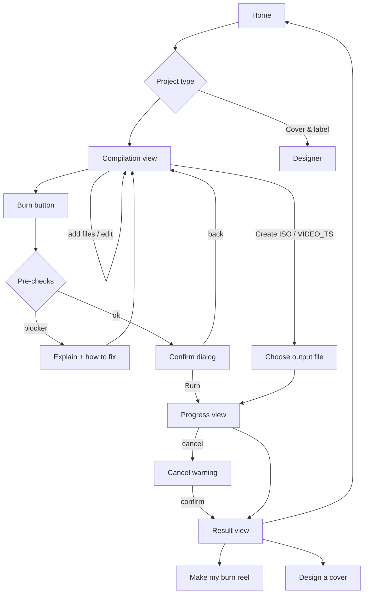
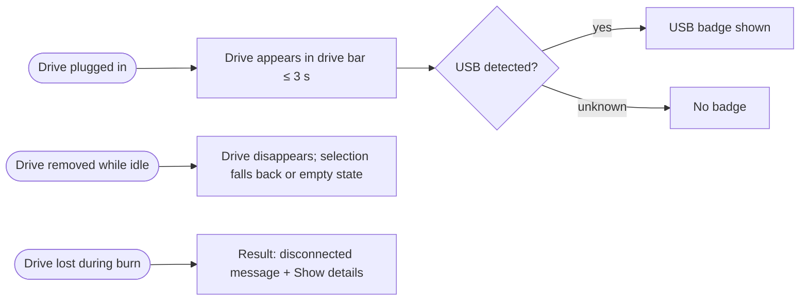

<!--
SPDX-FileCopyrightText: 2026 Chetan and contributors
SPDX-License-Identifier: GPL-3.0-or-later
-->

# UX specification and design system

| | |
|---|---|
| Status | Draft — refined with the data-burning UI (M4) and the retro themes (M9) |
| Audience | Developers building views and themes |

## 1. Principles

1. **Say what will happen, in plain words.** Explain why something is not
   possible instead of only greying it out.
2. **Nothing destructive without a clear "yes".** Confirmation names the drive,
   the disc and the consequence.
3. **Fun, but never at the cost of clarity.** Animation and sound decorate
   state; they never carry it alone.
4. **Same frame for every project type.** Drive bar at the top, compilation in
   the middle, the big action button bottom-right; shared confirm, progress
   and result screens.
5. **Original look.** Inspired by early-2000s desktop software in spirit only;
   no logos, icons, sounds or names of any real product or OS.

## 2. Screen inventory

| Screen | Purpose |
|---|---|
| Home | "What do you want to make?" — cards: Data disc, Audio CD, MP3 disc, Video DVD, Burn ISO, Create ISO, Cover & label |
| Compilation views | One per project type (file tree, track list, MP3 layout, DVD titles + menu, ISO picker) |
| Drive bar | Shared strip: drive picker, media info, capacity bar, USB badge, refresh |
| Confirm dialog | Summary, drive + media, options (verify, speed), USB tip, battery warning, sleep note |
| Progress view | Spinning disc, step list, overall %, speed, ETA, buffer, cancel |
| Result view | Success / failure / cancelled, verify report, "Show details", "Make my burn reel", "Design a cover" |
| Cover & label designer | Template picker, canvas, element palette, properties panel |
| Reel export | Preview, hide-names toggle, length, export, open folder |
| Settings | Theme, sounds, verify, speed, sleep prevention, USB tips, work folder, temp files, TV standard, paper size, MP3 bitrate, car-compat defaults, reel options, tool paths and status |
| Help → About / Open-source licenses | Version, licence, source link, no-warranty; component list with full licence texts |
| First-run dependency check | Tool status with fix hints |

## 3. Main flows





## 4. Wireframes (low fidelity)

**Home**
```
+--------------------------------------------------------------+
| RetroBurn                                     [Settings] [?] |
|                                                              |
|          What do you want to make?                           |
|                                                              |
|  [ Data disc ] [ Audio CD ] [ MP3 disc ] [ Video DVD ]       |
|  [ Burn ISO  ] [ Create ISO ] [ Cover & label ]              |
|                                                              |
|  (disabled card shows a one-line reason, e.g.                |
|   "Needs FFmpeg — see Settings")                             |
+--------------------------------------------------------------+
```

**Compilation (audio CD)**
```
+--------------------------------------------------------------+
| Drive: [ HL-DT-ST DVDRAM (E:) v ] [USB]  CD-R  Blank  80:00  |
| [=============================-------------]  58:12 / 80:00  |
+--------------------------------------------------------------+
| Album: [__________]  Performer: [__________]                 |
| #  Title            Performer        Length    CD-Text       |
| 1  Sunrise Tone     Test Artist      3:20      ok            |
| 2  Café Tone        Test Artist      4:05      "Cafe Tone"   |
| ...                                                          |
| [+ Add files]  [Remove]  [Up] [Down]                         |
|                                             [ Burn audio CD ]|
+--------------------------------------------------------------+
```

**Progress**
```
+--------------------------------------------------------------+
|      (spinning disc)          Writing tracks… 42 %           |
|                               8x · 3:10 left · buffer 98 %   |
|  ✓ Converting tracks                                         |
|  ✓ Preparing CD-Text                                         |
|  ▶ Writing disc                                              |
|    Checking disc                                             |
|  Keep the laptop open and plugged in.          [ Cancel ]    |
+--------------------------------------------------------------+
```

## 5. Shared components and states

| Component | States |
|---|---|
| Drive bar | No drives (empty state with hint) · drive, no media · media ready · media incompatible (message) · busy (burning) · permission problem (message + fix) |
| Capacity bar | Under capacity · near full (≥ 95 %, warning colour) · over capacity (error colour, burn blocked, message) · calculating (indeterminate) |
| Project card | Enabled · disabled with reason |
| Big action button | Enabled · disabled with tooltip reason · running |
| Confirm dialog | Normal · with USB tip · with battery warning · rewritable erase warning |
| Progress view | Running · cancelling · finishing verify |
| Result view | Success · success with verify skipped · verify failed · failed · drive lost · cancelled |
| Spinning disc | Idle (still) · spin-up · burning (fast) · verifying (slow) · done (stops) · error (stops, error tint) |

## 6. Wording (source strings, English)

| Situation | Text |
|---|---|
| Audio CD on non-CD media | "Audio CDs can only be burned on CD-R or CD-RW. Insert a CD-R — it plays in the most players." |
| Video DVD on non-DVD media | "Video DVDs need a DVD. A DVD-R works in the most players." |
| No drive | "No disc drive found. Plug one in — it will show up here automatically." |
| Linux permission | "RetroBurn can't use this drive. Add your user to the 'cdrom' group, then log out and back in." |
| Over capacity | "This is {excess} too big for the disc. Remove some items or use a bigger disc." |
| USB tip | "Connect the drive directly to the laptop (not through an unpowered hub), use its Y-cable or a powered hub if it has one, and keep the laptop plugged into the charger." + [Don't show again] |
| On battery | "Your laptop is running on battery. Plug in the charger so the burn isn't interrupted." |
| Sleep note | "RetroBurn keeps your computer awake while burning. Closing the lid or choosing Sleep can still interrupt the burn." |
| Sleep unavailable (Linux) | "RetroBurn couldn't stop the computer from sleeping. Keep it awake until the burn finishes." |
| Drive lost | "The drive was disconnected or lost power. A write-once disc may now be unusable; a rewritable disc can be blanked and reused." + [Show details] |
| Cancel warning | "Stop burning? A write-once disc may be unusable afterwards." |
| Erase confirm | "Erase this disc? All data on it will be deleted." |
| Non-Latin CD-Text | "CD-Text can only show Latin letters. Enter a Latin-script version of this title for CD-Text — the original stays on your cover and reel." |
| DRM input | "This file is copy-protected, so RetroBurn can't use it." |

All strings live in resource bundles; the table above is the starting copy.

## 7. Theme tokens

Themes are JavaFX CSS files that set these looked-up colours and sizes on
`.root`; components use only the tokens.

| Token | Purpose | `classic` (proposed) | `y2k` (proposed) |
|---|---|---|---|
| `-rb-bg` | Window background | `#F4F5F7` | `#C9D6E8` |
| `-rb-surface` | Panels, cards | `#FFFFFF` | `#E6EEF8` gradient |
| `-rb-text` | Body text | `#1B1F24` | `#0B1A33` |
| `-rb-text-muted` | Secondary text | `#59636E` | `#33476B` |
| `-rb-accent` | Primary action, progress | `#1F5FBF` | `#1E6FD9` |
| `-rb-accent-text` | Text on accent | `#FFFFFF` | `#FFFFFF` |
| `-rb-success` | Success state | `#1E7B34` | `#1F8F3A` |
| `-rb-warning` | Warnings, near-full | `#8A5A00` | `#B36B00` |
| `-rb-error` | Errors, over-capacity | `#B3261E` | `#C62828` |
| `-rb-focus` | Focus ring | `#1F5FBF` | `#FF9F1C` |
| `-rb-radius` | Corner radius | `6px` | `3px` (bevelled) |
| `-rb-font-body` | Body font | System UI | System UI |
| `-rb-font-display` | Headers, LED display | System UI | VT323 (OFL) |

`classic` text/background pairs must meet WCAG AA (4.5:1 for body text, 3:1
for large text and UI components); this is checked when the theme is built.
`y2k` adds bevelled buttons, a gradient header and a segmented LED-style
progress bar.

## 8. Accessibility rules

- Every action reachable by keyboard; visible focus ring on every focusable
  control; logical tab order.
- Shortcuts: `Ctrl+O` add files, `Delete` remove selected, `Alt+Up/Down`
  reorder, `Ctrl+S` save project, `Ctrl+Z` / `Ctrl+Y` undo/redo in the
  designer, `Esc` closes dialogs (never confirms a destructive action).
- Destructive buttons are never the default button.
- Sounds always accompany visible state; sounds default off in `classic`.
- Respect the OS's reduce-motion preference where detectable; otherwise offer a
  setting to stop the disc animation.
- Labels for all inputs and icon-only buttons (accessible text).
- Never rely on colour alone: capacity states also use text and icons.

## 9. Sounds

| Event | Sound | Default |
|---|---|---|
| Burn starts | spin-up | On in `y2k`, off in `classic` |
| Writing | burning loop (quiet) | same |
| Success | success chime | same |
| Error | error tone | same |

All sounds are original (procedurally generated) or CC0 with source recorded
in `assets/CREDITS.md`.
